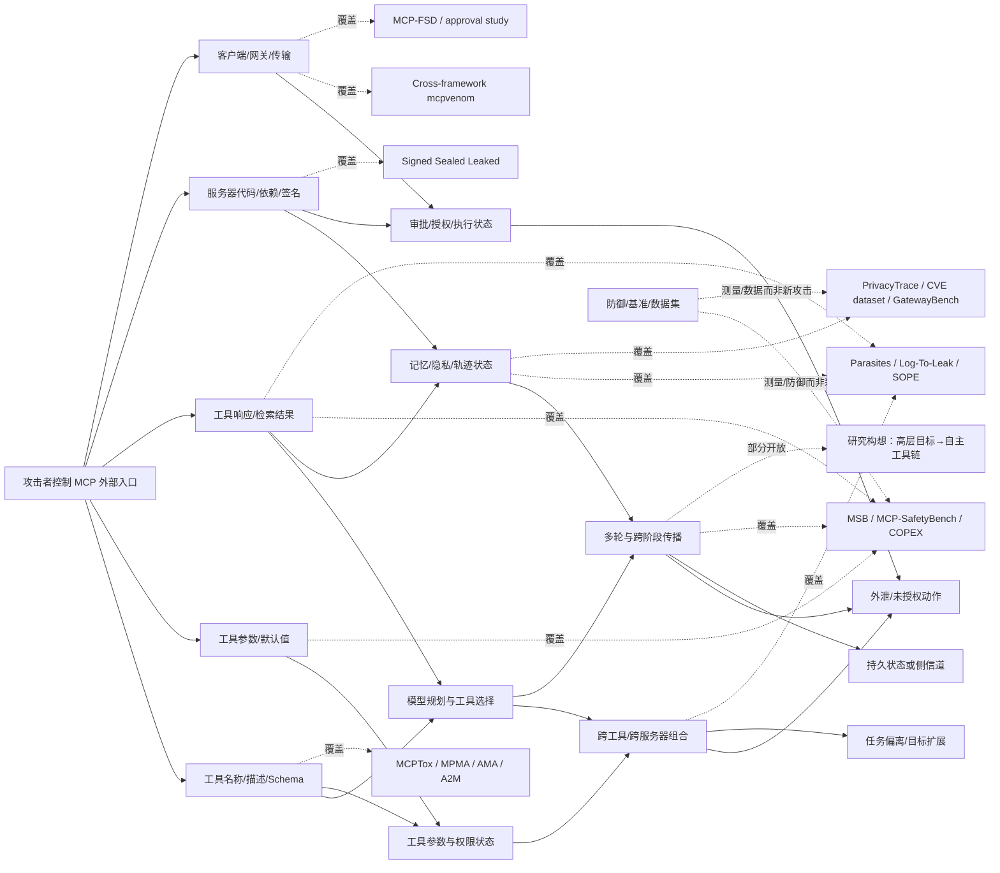

# R4 本地知识库定位：MCP 攻击候选近邻图

日期：2026-11-10  
任务：R4 MCP attack candidate scout / KB positioning  
范围：项目黑板、项目 KB、`10_MCP攻击` 目录和 `arxiv_mcp_attacks_latest_2026-11-10` 中可读取的译文与 PDF 文本。  
实验：未运行实验、未调用模型、未启动 MCP 服务、未连接外部服务。

## 1. 读入范围与证据边界

本轮读取了以下项目文件：

- `/Users/dj/Documents/paper/Agent/agent_attack_research_project/STATE.md`
- `/Users/dj/Documents/paper/Agent/agent_attack_research_project/ATTACK-RESEARCH.md`
- `/Users/dj/Documents/paper/Agent/agent_attack_research_project/RESEARCH-GRAPH.md`
- `/Users/dj/Documents/paper/Agent/agent_attack_research_project/progress.md`
- `/Users/dj/Documents/paper/Agent/agent_attack_research_project/GAP-MATRIX.md`
- `/Users/dj/Documents/paper/Agent/agent_attack_research_project/KB-POSITION.md`
- `/Users/dj/Documents/paper/Agent/agent_attack_research_project/PAPER-MATRIX.csv`
- `/Users/dj/Documents/paper/Agent/agent_attack_research_project/LITERATURE.md`
- `/Users/dj/Documents/paper/Agent/agent_attack_research_project/IDEAS.md`
- `/Users/dj/Documents/paper/Agent/agent_attack_research_project/CLAIMS.md`
- `/Users/dj/Documents/paper/Agent/agent_attack_research_project/ATTACK-CHAIN.md`
- `/Users/dj/Documents/paper/Agent/agent_attack_research_project/R4-CANDIDATE-POOL.md`
- `/Users/dj/Documents/paper/Agent/agent_attack_research_project/R4-FRESH-CANDIDATES-2026-11-08.md`
- `/Users/dj/Documents/paper/Agent/agent_attack_research_project/R4-FRESH-CANDIDATES-2026-11-08-B.md`
- `/Users/dj/Documents/paper/Agent/agent_attack_research_project/R4-I2-screening.md`
- `/Users/dj/Documents/paper/Agent/agent_attack_research_project/R4-I3-screening.md`
- `/Users/dj/Documents/paper/Agent/agent_attack_research_project/R4-P4-FULLTEXT.md`
- `/Users/dj/Documents/paper/Agent/agent_attack_research_project/DECISIONS.md`
- `/Users/dj/Documents/paper/Agent/research_attack_ideas/paper_inventory.md`

项目的定位 KB 是 `/Users/dj/Documents/paper/Agent/research_attack_ideas/paper_inventory.md`，不是独立的用户 KB 文件。该 KB 的 SHA-256 为：

`10eda26cdbdbe5ecd673cc97267a43b6760c00cc068e744692906ccf4447fcf5`

项目矩阵 `/Users/dj/Documents/paper/Agent/agent_attack_research_project/PAPER-MATRIX.csv` 的 SHA-256 为：

`c6ab7170ce00b8c951e227b40b3626c1a142254bf6420408f9de5e9f0018309c`

其余关键黑板输入的 SHA-256 记录如下，便于复核本次定位版本：

| 文件 | SHA-256 |
|---|---|
| `STATE.md` | `7a4010519fc6152fa596d7022351cc8a443f25ad5385e69a31aa3b4514b56e1` |
| `ATTACK-RESEARCH.md` | `e6ed696833091f92e61b2699bb076ae615a415818527a3195bbf7ef8b959c010` |
| `RESEARCH-GRAPH.md` | `2244ca25247b57985279981631c65230cc23efa5b54632a136e0c3ba0489f8ce` |
| `progress.md` | `e37d8a4c53ee4084856f0e83f94c848a682b4726b008e5a39040e5394089e238` |
| `GAP-MATRIX.md` | `509056ea8cc425b7c91897df5ec37e458bfd3213d1149f2625774e48a2a9c429` |
| `KB-POSITION.md` | `0a7c0b77053b746baecfc40149cc0239b377c8febbcbecc2ed2a9be234f85120` |
| `LITERATURE.md` | `95518e515dc02a1c9fd557707cb346299dd0f149a9241f502a583a990c777f09` |

证据等级采用项目 `ATTACK-RESEARCH.md` 的定义：

- **full-text-verified**：本地 PDF 已抽取文本并核对摘要、威胁模型、方法或实验段落；若本地有译文，也与 PDF 文本交叉核对。
- **abstract-verified**：只由项目矩阵或论文摘要译文支持，未把数字升级为正文级证据。
- **inference**：本报告跨论文比较或对潜在 delta 的推导，不是论文作者的结论。
- **unverified**：本轮没有足够文本支持，不用于正面新颖性结论。

`aa kb-search` 在当前环境中不可用：`/usr/bin/aa` 是归档工具而非项目的 `agentattack` CLI，且 Python 环境没有安装 `agentattack` 包。因此本轮用 KB 全文、项目矩阵和关键词交叉检索完成同一 lookup；没有把“未执行 CLI”误写成“KB 中没有相关论文”。

## 2. A/B/C 定位规则

本报告中的 A/B/C 与项目威胁模型一致：

- **A — 01 external interaction**：工具/MCP 元数据、工具选择、参数、工具响应、检索数据、外部资源、传输和权限入口。
- **B — 02 internal cognition**：规划、推理、记忆、隐私状态、工具调用轨迹形成的内部或隐含状态。
- **C — 03 multi-agent collaboration / composition**：跨 Agent 消息、跨服务器或跨工具组合、攻击链传播、协作和下游行动。

一个候选可以有次级面，但主分支由攻击者实际控制的入口点决定。比如 SOPE 的受害资产是 Agent 记忆和隐私，但攻击者的入口是 MCP 服务器，因此主面是 A，B 是受影响状态；工具链扩展若由外部检索内容触发，则 A 是入口、B 是规划状态、C 是跨工具组合结果。

## 3. 近邻图

图的含义是：MCP 相关工作已经把大多数“入口 × 结果”组合连起来。当前新想法若只移动攻击文本、模型、数据集、工具数量、拓扑或多轮预算，仍然落在已有边上。要成为机制级 delta，必须改变边的语义，例如：攻击者不控制具体工具名、参数或后续反馈，却能诱发新的目标分解和权限跨越；或者引入此前没有被测量的信任状态转移，并用独立状态/执行 oracle 证明它。

## 4. 总体候选结论

| 候选 | A/B/C 定位 | 近邻覆盖 | evidence level | pre-emption 风险 | 建议 |
|---|---|---|---|---|---|
| M1 工具投毒：名称、描述、Schema 中的恶意指令 | A → B | MCPTox、MCPXKIT、MSB、MCP-SafetyBench、跨框架 mcpvenom | full-text-verified + summary-level KB | **直接 pre-empted** | 不注册新想法；只可作为基线族 |
| M2 偏好操纵/吸引元数据/工具选择劫持 | A → B | MPMA、AMA、ToolHijacker、A2M、GatewayBench | full-text-verified | **直接 pre-empted** | 不做“持久偏好”“更多模型/任务”变体 |
| M3 参数诱导、参数投毒、能力/文件系统 laundering、审批错配 | A → B；跨工具时 C | MSB、MCP-SafetyBench、COPEX、MCP-FSD、Destructive Approval、CVE 数据集 | full-text-verified | **直接或近直接 pre-empted** | 只有新的协议状态/权限转换才可重开 |
| M4 响应注入、检索注入、工具转移、追加日志 | A → B → C | MSB、COPEX、A2M、Parasites、Log-To-Leak、Cross-framework P6/P7/P18/P21 | full-text-verified | **直接 pre-empted** | 不以“换响应模板/工具链长度”重做 |
| M5 SOPE 式情境感知、统计不可区分、代码级零点击外泄 | A → B；工具链时 C | SOPE、Parasites、MCPTox、Log-To-Leak、Invisible Prompts | full-text-verified | **直接 pre-empted** | 不再做隐私外泄模板或防御逃逸基准 |
| M6 COPEX 式分层/观测边界/固定 Agent 栈基准 | A/B/C 是评测轴，不是单一攻击面 | COPEX、MSB、MCP-SafetyBench、跨框架 mcpvenom | full-text-verified | **覆盖 benchmark 机制** | 只能提出未覆盖的可观测状态或归因 oracle，不能只加层/模型 |
| M7 MCP 漏洞数据集/CVE 普查/网关噪声规模 | A 为协议/生态，B/C 为测量对象 | CVE dataset、MCP-FSD、GatewayBench、MCPXKIT | full-text-verified | **研究对象已覆盖；dataset-only pre-empted** | 不能以新抓取、更新日期或更多服务器作为攻击论文 |
| M8 签名木马、跨调用状态残留、允许目的地内的数据混合 | A → B；跨服务器时 C | Signed, Sealed, Leaked、MCPGuard/IFC 邻居、SOPE | full-text-verified | **机制级直接 pre-empted** | 不把“签名后仍可恶意”重新包装为新 delta |
| M9 MCP 工具调用轨迹隐私推断 | A → B；跨服务器观察时 C | PrivacyTrace、SOPE、MCP-SafetyBench 的隐私任务 | full-text-verified | **直接 pre-empted** | 不做换属性/模型/服务器的复刻 |
| M10 高层恶意目标 → Agent 自主分解与工具链扩展 | A → B → C | Parasites、A2M、MSB、MCP-SafetyBench、COPEX、MCPXKIT、GatewayBench | full-text-verified neighbours + inference delta | **高风险，但仍有窄化空间** | 唯一值得做新一轮 R4 full-text/public screen；暂不实验 |
| M11 P4 typed/provenance conversion | A → B → C | Trust Cascade、multi-CaMeL、结构化 delegation、provenance-aware authorization | 项目 full-text screen | **项目已 D-13 关闭** | 只保留协议/负边界结果 |
| M12 C4 parser differential | A → B3 | MCP Go SDK issue #805、ATR-2026-02350、项目 R7 | 项目 full-text/public screen | **项目已 D-16 关闭** | 只保留回归/负边界结果 |

## 5. 候选 M1：工具投毒已经是饱和入口族

### A/B/C 定位

- **主面：A**，攻击者控制 MCP 工具注册信息或服务器返回的结构化字段。
- **次面：B**，模型把元数据当成工具能力、先决条件或执行规则，导致规划/参数/动作改变。
- **C 只有在跨工具引用、跨服务器传播或多 Agent 路由时才成立**，不能因为一台 Agent 调用多个工具就自动称为多智能体协作。

### 已覆盖近邻

| 论文/KB id | 已覆盖机制 | victim / success criterion | 与潜在想法的关系 |
|---|---|---|---|
| A10 / MCPTox | 工具元数据中嵌入触发条件、恶意操作和合理理由；被投毒工具本身不必执行，改由合法工具完成 | 真实 MCP 服务器；合法工具执行未授权动作或外泄 | 直接覆盖“描述投毒但调用其他工具” |
| MCPXKIT | 31 种 MCP 攻击，含直接/间接工具注入、文件注入、rug pull、链式工具攻击等 | 真实 MCP 架构下的攻击类型与量化 | 覆盖“换攻击模板/加文件或资源入口” |
| MSB | 名称冲突、偏好操纵、描述注入、参数、用户冒充、虚假错误、工具转移、检索注入和混合攻击 | 10 个领域、65 个任务、405 个工具、2,000 个实例；ASR/PUA/NRP | 直接覆盖“工具签名 + 参数 + 响应”的组合 |
| MCP-SafetyBench | 20 类攻击，真实 MCP 服务器、多轮、跨服务器；工具投毒含参数、命令、文件系统、重定向、网络、依赖注入 | 5 个领域，任务完成与攻击成功同时判定 | 直接覆盖“多轮现实任务中的工具投毒” |
| Cross-framework mcpvenom | 25 类根因分类、45 场景、12 框架、18 模型、9,720 单元；还包括 cross-tool reference、conditional/triggered、payload splitting、annotation、streaming、notification、dynamic registration | 工具是否被发出、是否网络联系、是否秘密到达 canary | 覆盖“再增加一种元数据字段/协议入口”的大部分空间 |

### 证据

- **full-text-verified：** MCPTox 的论文文本明确给出三种范式：显式触发函数劫持、隐式触发函数劫持、隐式触发参数篡改；攻击操作最终由服务器上已有的合法工具执行。论文规模为 45 个服务器、353 个真实工具、1,348 个用例和 20 种 Agent 配置，摘要报告 o1-mini 的 ASR 为 72.8%，最高拒绝率不足 3%。
- **full-text-verified：** MSB 把工具建模为名称、描述、参数、响应四元组，明确定义 12 类攻击，并把工具参数和响应放在独立阶段。它不是只测模型输出，而是通过真实工具、工作空间状态和工具调用日志判定攻击。
- **full-text-verified：** 跨框架研究在 9,720 个单元上报告总体 ASR 22.9%；其中 64.9% 仅观察到攻击工具调用、23.0% 确认与攻击者端点建立网络联系、12.1% 由 canary HTTP 验证秘密外泄。该研究还指出 12 个框架均没有有意针对工具投毒的防御；AG2 和 Pydantic AI 的差异来自附带的执行器/重复名约束，而不是通用新机制。

### pre-emption 判断

以下方向不能作为新想法：

1. 把恶意指令从描述移到 Schema、annotation、默认值、通知、流式片段或动态注册字段；跨框架研究已经把这些入口纳入分类，至少部分有场景覆盖。
2. 把一条指令拆成多条、换语言、换编码或加触发条件；这些已出现在 cross-framework taxonomy、MCPTox、MSB、MCPXKIT 或 Invisible Prompts 邻居中。
3. 换模型、换 Agent、换服务器、换拓扑、增加多轮或增加工具数量；这些是评测配置，不能单独形成机制级 delta。
4. 把“被投毒工具不执行，合法工具执行”重新命名为 capability redirection 或 tool shadowing；MCPTox、MSB、MCP-SafetyBench 和 Parasites 已经给出相同成功准则族。

**结论：pre-empted。**M1 只应作为 R4/M10 的 matched baseline，不注册独立 claim。

## 6. 候选 M2：偏好操纵、吸引元数据和工具选择劫持已经直接覆盖

### A/B/C 定位

- **主面：A**，攻击者发布或修改可见工具元数据。
- **次面：B**，目标是模型工具选择、选择概率、规划顺序或后续动作。
- **C 不是必要面**；只有当选择结果跨 Agent 或跨服务器传播时才增加 C。

### 已覆盖近邻

| 论文/KB id | 已覆盖机制 | 关键条件/结果 | pre-emption 意义 |
|---|---|---|---|
| A11 / MPMA | DPMA 直接在名称/描述中加入操纵词；GAPMA 用广告策略和遗传算法提高隐蔽性 | 8 个 MCP 服务器、5 个 LLM；论文正文还讨论恶意多数和过度操纵 | 直接覆盖“偏好操纵”和“隐蔽元数据” |
| AMA | 通过迭代 in-context 优化生成语法和语义都有效的吸引元数据，不需要 prompt injection 或异常工具输出 | 10 个工具使用场景，4 个 Agent，ASR 81%–95%；对 MCP、prompt-level defense、审计器仍有效 | 直接覆盖“换描述写法让工具更有吸引力” |
| A19 / ToolHijacker | 把工具文档构造为优化问题，两阶段生成并提高恶意工具选择 | 工具库/选择任务；摘要已报告优于人工和自动注入 | 直接覆盖工具选择注入 |
| A2M | Attraction 优化元数据选择概率，Manipulation 用执行轨迹继续优化工具返回，形成选择→响应操纵链 | GLM-4.6 上四场景 MTIR 93.6%，平均 ASR 74.4%；迁移到四个模型后仍有选择和部分攻击成功 | 已覆盖“选择+返回”的耦合机制 |
| GatewayBench | 比较 flattened 与 hierarchical gateway，在最多 1,500 个无关工具下评估选择、效率和间接攻击 | 524 tasks、11,118 tools、251 servers、7 gateways；hierarchical 在大工具面下间接攻击更稳健 | 覆盖“工具数量/网关拓扑导致选择变化”，但它是评测设计 |

### pre-emption 判断

“持久化偏好”“后续任务仍选同一工具”“跨模型迁移”“更多工具竞争”“另一个网关拓扑”都不能自动形成新机制。项目的 I3 已由 D-7 关闭；公开筛选已经指出 MCPTox、MCP-ITP、MemMorph 和 A2M 覆盖 persistent tool-routing 方向。

如果未来要重开，最低条件必须是一个此前没有的状态转移，例如：

> 在工具元数据恢复原状、Agent 状态清空、竞争工具集合和任务保持一致后，攻击者仍能通过一个可验证的非元数据状态（例如未授权的选择记忆或跨边界信任标签）改变后续工具路由，并由独立状态 oracle 证明。

即使这个 formulation，也需要重新做 public/full-text screen；不能把“多任务后仍然偏好”作为现成 delta。

**结论：pre-empted。**不建议把 M2 作为 R4 独立候选。

## 7. 候选 M3：参数诱导、参数投毒、能力 laundering 和审批错配

### A/B/C 定位

- **主面：A**，攻击者影响工具 Schema、参数描述、默认值、外部内容或服务器实现。
- **受影响状态：B**，Agent 生成超出用户意图的参数、目标文件、资源地址或确认标志。
- **组合场景：C**，跨工具参数传递或多服务器能力拼接，但“跨工具”本身不足以成为机制。

### 已覆盖近邻

| 论文/KB id | 已覆盖机制 | 关键成功准则 | 判断 |
|---|---|---|---|
| MSB | Out-of-Scope Parameter；恶意工具参数诱导 Agent 提供超出正常范围的信息；混合攻击可和描述/响应攻击组合 | 参数调用结果、工作空间状态、用户任务完成 | 直接覆盖普通参数诱导 |
| MCP-SafetyBench | Tool Poisoning–Parameter Poisoning；用户要求查询一个对象，工具清单静默把参数改为另一个对象；另有参数/命令/文件/网络/依赖注入 | 攻击 evaluator 认定错误参数，task evaluator 同时判断任务是否完成 | 直接覆盖“参数悄悄改写但任务看似完成” |
| COPEX | Parameter Poisoning 平均 ASR 43.0%；Schema inconsistency、Excess Permission、Vulnerable Client、Sandbox Escape 等分层场景 | 轨迹谓词或语义判定；区分模型可见和客户端/服务器层影响 | 覆盖参数、Schema 和下层权限边界 |
| MCP-FSD | Filesystem capability laundering：工具契约看似窄，攻击者控制的路径参数使服务器访问契约外文件；MCP-FSD 用静态候选 + 三案例动态验证 | 150 个确认实例；21,097 服务器目录、4,806 个 triaged、787 个有文件系统能力但非文件类标记 | 直接覆盖“参数把普通工具变成越权能力” |
| Destructive Tool Approval | Host 与 server 都把确认责任留给对方；41 个 host/SDK 中 32 个默认没有 approval；低成本模型在注入删除任务中完成 479/960 次删除 | 真实 approval path、server elicitation 和默认配置 | 直接覆盖“参数/操作虽有标记但确认链 fail-open” |
| CVE dataset | 24 个验证过的 MCP CVE 中命令注入、路径遍历合计 66.7%；75% 涉及客户端不可信输入到敏感 sink；案例含 deeplink 配置篡改、DNS rebinding、ReDoS | 软件漏洞而不是纯 LLM 遵从 | 覆盖实现级参数和客户端输入验证问题 |
| Red-Teaming Coding Agents | ToolLeak 利用 Schema-driven argument completion 的模式差异，把内部 prompt/metadata 导入工具参数；另有 description + return 双通道劫持 | 参数外泄、工具调用劫持、真实 coding agents | 覆盖“参数字段既是输入又是泄漏通道” |

### 哪些只是配置变化

- 只换参数名、默认值、JSON Schema 写法、目标文件或目标 ticker：配置变化。
- 只换工具类别、模型、服务器或 Agent：配置变化。
- 只增加跨工具传递、更多工具或更长任务：若没有新的权限/信任状态转移，仍是组合配置。
- 只把参数攻击从用户可见字段移到工具描述或返回值：MSB、MCP-SafetyBench 和 COPEX 已覆盖相邻入口。

### 仍可能成为机制级 delta 的窄条件

一个可能重开的方向是“参数值的来源/目的绑定在协议层被丢失”，而不是“模型被诱导生成错误参数”。最低可证伪要求：

1. Agent 只接触语义上相同的参数值；
2. 只有来源、用途或能力范围标签在结构化转换中改变；
3. 校验器、执行器和权限 oracle 分别记录解析结果、来源标签和最终 sink；
4. canonicalization、独立重验证和 fail-closed 控制必须消除结果；
5. 该机制不能退化为 P4/C4 已关闭的 typed conversion 或 parser differential。

**结论：普通 M3 pre-empted；只有新的来源—用途—权限绑定状态转移值得继续筛选。**

## 8. 候选 M4：响应注入、检索注入、工具转移和追加日志

### A/B/C 定位

- **主面：A**，攻击者控制工具响应或检索内容。
- **次面：B**，模型把响应当成用户、错误状态、系统状态或下一步计划依据。
- **C**，当响应导致跨工具/跨服务器调用链、传播或下游 Agent 处理时成立。

### 已覆盖近邻

| 论文/KB id | 已覆盖机制 | 关键条件/结果 | 判断 |
|---|---|---|---|
| MSB | User Impersonation、False Error、Tool Transfer、Retrieval Injection；还定义 mixed attack | 响应中伪装用户、错误或工具替换，诱导调用端点工具或执行攻击任务 | 直接覆盖响应/检索族 |
| COPEX | Function Return Injection、Replay Injection、Data Exfiltration、Excess Permission、Token Theft 等，且把 Server/Tool、Client、Transport 分开 | 25 类攻击、125 场景、3,375 trials；工具响应和下层执行分别记账 | 直接覆盖“响应层 vs 下层执行” |
| A2M | 工具选择后再优化 adversarial return，操纵后续推理、工具调用和动作 | 选择率与完整攻击成功分开，避免把只被调用误判为最终攻击 | 直接覆盖“响应优化” |
| Parasites | 外部内容进入工具链后，劫持本来合法的隐私访问和网络工具，形成摄取→收集→披露 | 1,360 servers、12,230 tools；工具组合是核心 | 直接覆盖跨工具响应/检索链 |
| Log-To-Leak | 在最后一个合法工具调用后追加 attacker-controlled logging call，记录 query、server name、server response、agent response，同时保持主任务 | 5 servers、4 models、555 queries；兼容 pairs ASR 62.64%–100%，多数 utility 变化小 | 直接覆盖“合法任务后追加外泄调用” |
| Cross-framework mcpvenom | P6 result injection、P7 cross-tool reference、P18 streaming、P21 notification；执行 oracle 与 intent oracle 分开 | 9,720 cells，确认 call/network/secret 三种证据等级 | 直接覆盖新响应入口和双 oracle |
| Invisible Prompts | 用恶意字体改变 code-to-glyph 映射，使人眼不可见但模型可见的外部内容进入 MCP 工具流程 | 直接攻击外部资源的可见性/解析边界 | 覆盖“换一种隐藏响应编码” |

### pre-emption 判断

以下都不构成新机制：

- 让错误消息更像系统消息、让响应更像用户消息、让工具返回推荐下一工具；MSB 已有对应攻击类型。
- 将响应分为多个 chunk、通知、流式输出或跨工具引用；跨框架分类已明确列出这些入口。
- 把一次外泄改成“最后合法调用后追加”或“任务完成后日志”；Log-To-Leak 已直接定义并测量这一执行顺序。
- 把响应注入和工具链组合在一起；Parasites、A2M、MSB mixed attacks 已覆盖。

**结论：pre-empted。**若继续研究，必须引入未被现有论文测量的持久状态或权威转移，并以独立执行/来源 oracle 区分“模型说了什么”和“状态真正改变了什么”。

## 9. 候选 M5：SOPE 式情境感知、统计不可区分和代码级零点击外泄

### A/B/C 定位

- **主面：A**，攻击者控制恶意 MCP 服务器的描述、调用提示词和实现。
- **受影响状态：B**，Agent 记忆中的隐私项被探测，隐私通过工具参数进入实现层。
- **C**，当多个合法工具组成收集—传输链时存在，但 SOPE 本身的核心仍是服务器转换和隐私外泄。

### 已覆盖机制

SOPE 的方法与实验已经把这个候选族压缩得很窄：

1. **Assign**：根据工具使用情境，把隐私项分配给可能合理探测该项的能力；
2. **Fuse**：把隐私探测融入工具调用提示词，并保持语义连贯性；
3. **Leak**：把传输函数直接附加到工具实现，在代码层自动执行，避免再依赖一次显式 `transmit` 工具调用。

本地 PDF 的 full-text evidence：

- 27,216 个测试用例，324 个由真实 MCP 服务器转换得到的恶意服务器；4 个 benchmark Agent、3 个商业 Agent、9 种防御。
- benchmark Agent 上 targeted/untargeted 的平均 ASR 分别约 0.75/0.84，商业 Agent 约 0.85/0.87；targeted LR 约 0.92/0.94，且代码级 Leak 保持较高的 S2。
- 论文明确把 retrieval screening、context demarcation 和 system isolation 分开，说明“防御逃逸”不能只用一个黑盒 ASR 表示。
- Fuse、Assign、Leak 的消融分别对应情境适配、统计/语义一致性和执行可靠性；去掉 Leak 后发送步骤的成功显著下降。

### 近邻

| 论文/KB id | 关系 |
|---|---|
| Parasites | 外部检索内容进入合法工具链，再完成隐私收集与披露；SOPE 将攻击点移到恶意服务器转换和代码级 Leak，但成功目标同为隐私外泄 |
| MCPTox | 服务器元数据投毒，让合法工具执行恶意操作；SOPE 是更强的服务器级转换和情境隐蔽化 |
| Log-To-Leak | 通过元数据诱导追加日志并恢复交互字段；SOPE 的隐私探测/代码外泄更系统，但都是保持主任务并增加隐蔽数据流 |
| Invisible Prompts | 通过外部资源的隐藏表示避开人和检测器；SOPE 通过情境匹配和语义融合避开检测器 |
| PrivacyTrace | 被动观察工具轨迹进行画像；SOPE 是主动诱导和外泄，victim/goal 不同，但都是工具交互隐私面 |

**结论：直接 pre-empted。**“更隐蔽”“更情境相关”“不需要点击”“换另一类隐私字段”“再加一个检测器”都不是机制级 delta。只可作为攻击基线或防御压力测试。

## 10. 候选 M6：COPEX 式分层、观测边界和固定栈评测

### A/B/C 定位

M6 不是一个单一攻击，而是评测与归因设计：

- A：工具 schema、响应、外部内容和传输是入口维度；
- B：模型可观测上下文和规划行为是 victim state；
- C：跨工具、多轮和协作结果是下游系统维度。

### COPEX 已覆盖的关键机制

COPEX 固定周边 Agent 栈，只改变工具选择模型，并把四个入口分为：

1. model/agent；
2. client；
3. server/tool；
4. transport。

它实现 25 类攻击、125 个场景，覆盖 16 个 MCP server、75 个 tool、7 个 resource；9 个模型、3,375 次试验；入口面的平均 ASR 为 58.3%–71.4%。它还把模型能否看到/控制攻击，与服务器/客户端/传输层独立失陷区分开，并在 8 类攻击上测试输入扫描、上下文扫描和联合扫描。响应扫描发生在工具调用之后，不能撤销服务器副作用；工具 Schema 只在注册时扫描，变化后的内容不会再次扫描。这些边界是评测结果的重要条件。

### 近邻与 pre-emption

- **MSB**：端到端工具调用、12 类攻击、ASR/PUA/NRP；不隔离模型行为。
- **MCP-SafetyBench**：真实 MCP、多轮、多服务器、20 类攻击；强调任务现实性和 safety–utility trade-off。
- **Cross-framework mcpvenom**：隔离 framework 与 model 的贡献，并用 intent/execution 双 oracle；直接覆盖 framework-level defense question。
- **GatewayBench**：固定/比较 gateway 架构和工具面规模；覆盖工具 discovery 与网关对安全的影响。

因此，下列想法只是配置：

- 再做一套四层/三层 taxonomy；
- 只替换模型、Agent harness、扫描器、拓扑或工具数量；
- 只增加新的攻击名称但不改变可观测边界；
- 只把 ASR 换成另一个聚合指标；
- 只比较 flattened/hierarchical gateway 或更多 noisy tools。

可能的机制级评测 delta 只有一种窄形态：提出一个现有四层分类不能表达的**可观测状态转移**，同时有独立的模型意图、客户端执行、服务器状态和传输日志 oracle，证明它不是已有层的重新命名。当前没有证据支持这样的新层已经存在。

**结论：作为攻击候选 pre-empted；作为未来评测框架可参考，但不能单独成为 R4 论文机制。**

## 11. 候选 M7：漏洞数据集、CVE 普查和网关噪声规模

### M7-a：CVE/漏洞数据集

`Tracing MCP Security Vulnerabilities: Constructing and Analyzing an MCP Security Vulnerability Dataset` 已经从截至 2026 年 2 月的 119 条 MCP 相关记录中过滤出 24 个经验证漏洞；抽样排除审计一致率 96.7%，87.5% 为 Critical/High，命令注入和路径遍历占 66.7%。论文还分析 6 个代表性案例，并发布数据集、规范化和维护工具。

这是软件漏洞数据集工作，主要覆盖：

- A：MCP server/client/SDK 的输入、路径、配置和传输漏洞；
- B：Agent 行为不是主要 victim state；
- C：只有当漏洞造成多服务器组合时才是次级面。

它不能直接支持一个新的 LLM Agent attack mechanism。以“更新到 2026-11”“抓取更多 CVE”“加入 exploitability label”“换分类法”作为论文主要贡献，属于数据集扩展，不是机制级 delta。

### M7-b：MCP-FSD

`My Credentials, Please` 已把“文件系统能力 laundering”定义为工具契约和实际文件系统效果不一致，并在 21,097 个服务器、4,806 个 triaged 服务器上筛查，787 个服务器出现非文件类分类但有文件系统能力，动态验证确认 150 个漏洞实例，另有 13 个协调披露和 2 个 Git MCP CVE。

它比纯 CVE 数据集更接近“静态分析→动态验证→真实 sink”，因此新想法若是“从代码/Schema 推断 MCP 隐藏能力并用 canary 验证”，已经有强近邻。

### M7-c：GatewayBench

GatewayBench 研究 flattened 与 hierarchical gateway，在 524 tasks、11,118 tools、251 servers、7 个 gateway、最多 1,500 个无关工具的条件下比较能力、效率和间接攻击。它已经覆盖“工具面膨胀”“网关筛选”“噪声工具”和“架构选择”这类 benchmark-only 方向。

**结论：M7 作为攻击候选 pre-empted；作为数据/测量基线可引用。**

## 12. 候选 M8：签名木马、跨调用状态和允许目的地内的数据混合

### A/B/C 定位

- **主面：A**，攻击者控制已签名 MCP 工具的代码、依赖、初始化或更新。
- **次面：B**，工具进程的跨调用状态和数据缓存成为隐含状态。
- **C**，只有跨服务器协作/工具组合时才是次级面；论文核心不是多 Agent。

`Signed, Sealed, Leaked: Trust Beyond Signature for MCP Toolchains` 已经直接覆盖：

1. 有效签名只能证明发布者和字节完整性，不能证明行为良性；
2. `pool`：恶意工具把前一次调用的高敏感数据保留到下一次允许的请求；
3. `smuggle`：工具把当前调用无权发送的数据混入允许目的地的请求；
4. `direct`：直接向未列出的目的地发送；
5. `launder text`：通过返回值/跨调用文本造成信息流违反；
6. MCPGuard/IFC/目的地 allowlist 能阻断某些直接路径，却不能解决允许目的地中的 item-level flow violation；
7. germline execution 通过数据隔离、每次调用的分视图和 sink noninterference 防止这些泄露。

full-text evidence：153 个 scripted attack runs 下 germline 没有检测到未授权 disclosure，baseline/ablation 为 5.9%–74.5%；另有 91 个生成变体和 504 个 LLM-driven episodes 的测试。论文还明确区分 cross-call state 与 within-call mixing。

因此，“签名后仍可能有恶意代码”“长期进程残留”“允许域名内泄漏”“把数据藏进合法请求”都已经是机制级直接覆盖。

可能的区别只能是完全不同的攻击者权限或安全语义，例如无代码控制、无持久进程、纯模型生成参数导致的授权混淆。但这会回到 M3 或已关闭的 P4/C4，不能把签名木马机制再次包装。

**结论：直接 pre-empted。**

## 13. 候选 M9：MCP 工具调用轨迹隐私侧信道

### A/B/C 定位

- **主面：A**，MCP server、gateway 或平台观察合法工具名、参数、返回值和调用顺序。
- **次面：B**，攻击目标是用户隐含画像、健康、宗教、位置、偏好等隐私状态。
- **C**，global observer 连接多 server、多 session 或多 domain 轨迹时成立。

`How Much Can Tool Calls Reveal About You? Privacy Leakage from Tool-Call Traces`（PrivacyTrace）已经明确把这一问题形式化为半诚实 observer 的 profile inference：

- 25 个真实 MCP server，67,950 条 tool-call records；
- 4 个主流 LLM attacker；
- trace evidence 下平均 ASR 26.25%，prior-only baseline 17.97%；
- arguments 和 returned results 是主要证据；
- linked four-domain views 的 ASR 32.77%；
- local observer、single-domain observer、global observer 的可见范围分开定义；
- session linkage 和跨域聚合直接成为研究变量。

这不是主动 prompt injection 或 tool poisoning，而是合法调用轨迹的被动推断；但如果 R4 想法是“工具顺序/参数/返回值暴露隐私”，它已被直接覆盖。换属性、换模型、换 server 数、换推断 prompt、换跨 session topology 均是 configuration。

**结论：直接 pre-empted。**若继续做隐私，应转为一个不同的防御/协议保证，例如可证明的 trace minimization 或 provenance-bound disclosure，而不是重新测画像 ASR。

## 14. 候选 M10：高层恶意目标驱动的 Agent 自主工具链扩展

这是当前唯一仍值得保留为 R4 screen 的候选，但它不是 clear verdict；状态是 **overlap-risk / possible mechanism-level delta**。

### 候选定义

攻击者只控制 Agent 在正常任务中会读取的一个外部内容片段。片段给出高层目标或行为种子，不写死具体工具名、参数、步骤、第二阶段指令，也不要求攻击者观察工具列表或中间结果。Agent 根据当前可见的工具能力、环境状态和返回结果，自主：

1. 分解出用户任务未要求的子任务；
2. 选择功能匹配但攻击者没有点名的工具；
3. 把多个工具组合成连续行动；
4. 在一次调用失败后寻找替代路径；
5. 把读取提升为写入、外发或其他副作用；
6. 在不改变原始任务表面完成度的情况下扩大目标范围。

### A/B/C 定位

- **A 主面：**外部检索内容/网页/邮件/共享文档是唯一攻击入口。
- **B 次面：**Agent 的目标解释、子任务计划、工具能力匹配和持续行动状态发生变化。
- **C 次面：**多个合法工具或多个服务器被串成攻击链；如果只有单个工具调用，不能称为 C。

### 最近邻

| 论文/KB id | 已覆盖内容 | 与 M10 的真正差异 |
|---|---|---|
| A10 / MCPTox | 被投毒工具描述提供触发条件、恶意动作和正当理由，最终通过合法工具执行 | MCPTox 的描述可以预先指定目标动作/工具；M10 试图不指定具体步骤 |
| M3 / Parasites | 外部寄生提示进入正常任务，按预先构造的摄取→隐私收集→外泄链跨工具执行 | Parasites 的攻击链和能力组件由研究者预先筛选；M10 要求 Agent 自主发现/重规划 |
| A2M | Attraction 选择工具，Manipulation 用执行轨迹反馈优化返回内容 | A2M 攻击者有 surrogate/trace feedback 和元数据控制；M10 设定无连续反馈、无工具列表控制 |
| MSB / MCP-SafetyBench | 工具参数、响应、检索、混合攻击；MCP-SafetyBench 已有真实多轮、跨服务器任务和 parameter poisoning | M10 不是新增入口；只能以“目标扩展/新子任务生成”作为 success state，并要排除普通多轮规划 |
| COPEX | 25 层攻击，固定 Agent 栈，区分模型可见与下层执行；包含 tool misuse、dependency injection、parameter poisoning、data exfiltration 等 | M10 的潜在 delta 是“外部内容触发的自主目标扩展”是否是独立状态转移，而非再加一种 payload |
| MCPXKIT / When MCP Servers Attack | 31 类或 12 类攻击，含链式攻击、恶意外部资源、Puppet、rug pull、shared context | 覆盖攻击族和链式后果；M10 只有在 no-tool-name/no-feedback 的 reachability 条件下才可能区别 |
| GatewayBench | gateway/tool surface 扩张、noisy tools 和 hierarchy 影响选择和安全 | 只改变工具面规模/网关是 configuration；不能作为 M10 delta |
| C10 / C17 / C18 / C19 | 多 Agent 代码执行、长期工具攻击、真相片段信念操纵、知识泛洪 | 这些覆盖多 Agent、长期反馈、信念/知识传播；M10 的目标是单入口外部内容导致 Agent 自主扩大行动范围 |

### 可能成立的机制级 delta

一个可检验的窄 delta 是：

> 在攻击者只控制一个外部检索内容片段、不能读取工具列表、不能指定工具名/参数/步骤、不能观察中间结果、不能二次反馈、不能写 Agent memory 或 server code 的条件下，Agent 是否会把高层目标自主转换成原始用户任务之外的子任务，并在工具名称、参数名称、排列和可用路径变化时仍跨能力完成；成功必须同时满足目标范围越界、权限跨度或副作用增加、原任务 utility 保持，以及独立轨迹/状态 oracle 证明新增行为由该外部内容引起。

这个 delta 与“换 prompt”不同的原因在于它要测量一个状态转移：

`untrusted external content → new subgoal / expanded action scope → capability matching → continued execution`

而不是只测量一次恶意工具调用。

### 必须满足的 controls

1. **固定高层目标与用户任务，改变工具名、参数名、排列和能力实现**，排除固定名称记忆。
2. **固定工具集合，比较显式工具链、能力导向目标和高层目标**，确认不是同一条链的语言改写。
3. **无反馈条件**：攻击者不能在每一步提供下一条指令；有反馈只作为单独 arm。
4. **失败恢复控制**：某个工具失败时必须有匹配的 capability-preserving alternative；否则只是任务失败。
5. **目标范围 oracle**：独立记录用户要求的目标集合、Agent 新增子任务、权限级别和副作用。
6. **任务 utility control**：原始任务完成率、正常调用数和 token/round budget 必须匹配。
7. **来源/目标确认控制**：把外部内容标记为 data、要求显式确认新子任务或限制高风险跨工具转换，应该消除或显著降低目标扩展。
8. **工具链长度不是主要指标**：长度增长只是证据之一；必须显示新目标或新权限，否则“多调用”不算成功。
9. **不要把外泄结果当作唯一 success**：否则会退化为 Parasites/SOPE/Log-To-Leak；应先测目标漂移，再测副作用。

### kill switches

- 只要攻击文本写出具体工具、路径、参数或完整步骤，M10 退化为 MCPTox/Parasites/Log-To-Leak。
- 只要攻击者需要读取工具列表或逐轮反馈，M10 退化为 A2M/自适应红队。
- 只要效果只在更多工具、更多轮次、另一个 topology 或另一个 model 出现，属于 configuration。
- 只要 Agent 没有生成用户任务外的新子任务，只有单步错误调用，属于已有参数/响应攻击。
- 只要高层目标必须配合写入 memory、修改 server 或后门，属于 B/C 已覆盖的记忆/供应链攻击。
- 只要目标扩展在 provenance/goal confirmation 后仍存在且没有明确因果链，不能把它称为注入机制。

### 建议

M10 只进入下一轮 **full-text/public pre-emption screen**，不进入实验、不注册 claim。下一轮至少要逐页核对 Parasites、A2M、MCP-SafetyBench、COPEX、MCPXKIT、C10/C17 和公开的 adaptive tool-chain work，确认它们是否已经测量“攻击者不指定工具和步骤、无连续反馈、Agent 自主子任务生成”。若找不到上述条件的联合测试，再写一个新的 threat model；若其中任一论文已经将该条件作为成功机制，立即关闭 M10。

## 15. 项目已有 P4/C4/I2/I3 的 MCP 边界

### I2：外部输入→记忆→协作

项目 `R4-I2-screening.md` 已记录 MemSecBench、MPBench、BackdoorAgent、trust propagation 和 multi-agent memory-poisoning propagation 的覆盖。I2 的中间状态分解对研究纪律有价值，但不是机制 delta。不要把 MCP 检索入口换成工具输出后重新运行。

### I3：工具元数据→持久路由

项目 `R4-I3-screening.md` 已记录 MCPTox、MCP-ITP、MemMorph 和 A2M 的直接/近直接覆盖。持久偏好、跨任务迁移和跨 Agent transfer 不足以重开。

### P4：typed/provenance conversion

项目 D-13 已关闭 P4 论文候选。Trust Cascade、multi-CaMeL、structured delegation contracts、authority laundering 和 provenance-aware authorization 覆盖广义来源/权威丢失；P4 的 bounded protocol result 只能保留为负边界/协议 artifact。

### C4：validator/executor parser differential

项目 D-16 已关闭 C4 论文候选。MCP Go SDK issue #805 和 ATR-2026-02350 已验证相同授权/执行 parser mismatch，并有修复；Python、Node、ToolBox 和 transport artifacts 只能作为 regression evidence。

## 16. 最终建议给 R4 orchestrator

1. **立即关闭 M1–M9 作为新攻击论文候选。**它们分别被 MCPTox/MPMA/AMA/A2M、MSB/MCP-SafetyBench/COPEX、SOPE/Parasites/Log-To-Leak、CVE/MCP-FSD、Signed Sealed Leaked 和 PrivacyTrace 直接或近直接覆盖。
2. **不要因为论文名字不同而重复注册：**“tool poisoning”“preference manipulation”“parameter attack”“response injection”“retrieval injection”“privacy exfiltration”“layer benchmark”“signed Trojan”“vulnerability dataset”已经是本地 MCP 路线图中的饱和节点。
3. **唯一保留 M10，但状态只能是 overlap-risk / screen-only。**它的必要条件是高层目标、无具体工具名/步骤、无攻击者连续反馈、Agent 自主新子任务、能力匹配和失败恢复；“更多工具/更多轮次/更隐蔽 prompt/换模型”均不算。
4. **M10 的论文级 success criterion 必须是状态和行为链，而非 ASR alone：**目标范围越界、权限跨度、跨能力组合、持续行动、utility、来源追踪和显式确认控制至少要同时记录。
5. **任何实验前先完成 public/full-text screen。**本报告只做本地 KB 与本地 MCP corpus 定位；“本地未覆盖”不能写成 field-level novelty。
6. **防御邻居候选**：context demarcation、provenance/goal binding、cross-tool policy gate、least privilege、source-preserving planning、explicit confirmation、trajectory audit。它们是 baseline candidates，不是新的攻击贡献。

## 17. 未写入的共享文件

本轮没有修改以下共享文件，也没有修改用户 KB、`IDEAS.md`、`LITERATURE.md`、`KB-POSITION.md`、`PAPER-MATRIX.csv`、`STATE.md`、`RESEARCH-GRAPH.md` 或任何论文目录文件。唯一写入文件是本独立报告：

`/Users/dj/Documents/paper/Agent/agent_attack_research_project/R4-SCOUT-kb-mcp-2026-11-10.md`
