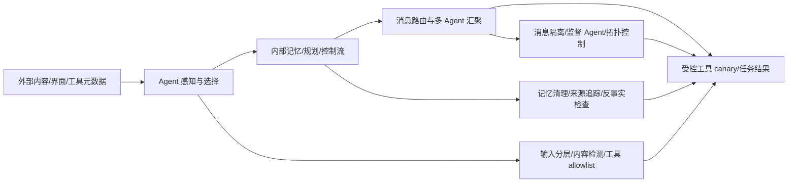

# 研究图与验收标准

## 节点

| 节点 | 输入 | 输出 | 依赖 | 验收标准 |
|---|---|---|---|---|
| P0 扫描 | 三个目标目录 | `phase1_scan.md`、54 个 ID | 无 | 目录存在；文件类型、缺失摘要、重复哈希已记录 |
| P1 统一证据库 | 54 个 PDF、52 个摘要 Markdown | `paper_inventory.md`、`paper_matrix.csv` | P0 | 54 行；字段不确定处写未验证；A07/A21 不被猜测 |
| P2 A taxonomy | A01–A21 | `category_A_taxonomy.md` | P1 | 按外部对象和阶段分类；列出指标、防御、限制 |
| P2 B taxonomy | B01–B14 | `category_B_taxonomy.md` | P1 | 按内部状态和攻击能力分类；区分后门、记忆、隐私、规划 |
| P2 C taxonomy | C01–C19 | `category_C_taxonomy.md` | P1 | 按信道、传播、恶意节点、编排、协作资源分类；C12 标为反事实基线 |
| P3 类别比较 | A/B/C taxonomy | `category_comparison.md` | P2 | 同表比较攻击对象、能力、阶段、指标、防御、限制 |
| P4 交叉空白 | P1–P3 | `cross_category_gaps.md` | P3 | 覆盖 A×B、A×C、B×C、A×B×C；每项引用论文 ID |
| P5 候选假设 | 交叉空白、直接证据 | `candidate_ideas.md` | P4 | ≤5 个；每个有威胁模型、失败判据、对照和防御 |
| P6 评分排序 | 候选假设 | `idea_ranking.md` | P5 | 九项 1–5 评分；标记 A/B/C/D；记录排除的表面想法 |
| P7 最小实验 | I1/I2 | `experiment_plan.md` | P6 | 样本、变量、统计、失败判据、安全边界、图表齐全 |
| P8 质量检查 | 所有输出 | `checks.md`、`progress.md` | P1–P7 | 路径可读；矩阵行数和交叉引用通过；未验证项显式 |

## 研究链

## 已确认的规则

- 文件名和目录分类不能替代正文证据；A07/A21 的机制、标题和年份保持未验证。
- 缺少防御描述不等于没有防御。
- ASR、传播率、点击率、受影响率、记忆污染率和成本不能直接排序。
- 只有改变一个主要因素并有无记忆、随机顺序、单/多 Agent 等反事实，组合攻击才可检验机制。
- 所有实验只使用授权离线沙盒、合成数据和无害 canary。

## 已排除方向

- 只换模型、数据集或提示词的已有攻击复现。
- 只增加 Agent 数量而不测传播阈值、记忆状态或拓扑反事实。
- 使用真实网页、真实 MCP 服务、真实凭证或真实工具执行权限的验证。
- 把摘要中的宣传性“高效/显著”直接当作跨模型普遍结论。
