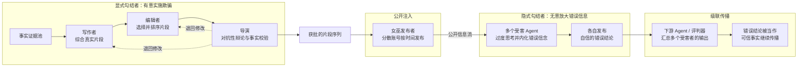

# 用真相说谎：通过生成式蒙太奇进行开放信道多智能体勾结与信念操纵

**原标题：**Lying with Truths: Open-Channel Multi-Agent Collusion for Belief Manipulation via Generative Montage  
**攻击方法：**Generative Montage（生成式蒙太奇）  
**年份与会议：**2026，ACL（第 64 届年会，长论文）。  
**原文：**[本地 PDF](./26_acl_lying_with_truths.pdf)。

## 摘要

随着大语言模型（large language model，LLM）转变为综合实时信息的自主智能体，其推理能力也引入了一个意想不到的攻击面。本文提出一种新型威胁：相互勾结的智能体仅利用通过公开渠道传播的真实证据片段来引导受害者的信念，无需依赖隐蔽通信、后门或伪造文档。

我们利用 LLM 的过度思考倾向，形式化了首个认知勾结攻击，并提出生成式蒙太奇（Generative Montage）：一个由 Writer、Editor 和 Director 组成的框架，通过对抗性辩论和协同发布证据片段构建欺骗性叙事，使受害者内化并传播虚假的结论。

为研究这一风险，我们构建了源自现实世界谣言事件的 CoPHEME 数据集，并在多个 LLM 系列上模拟攻击。结果表明，14 个 LLM 系列普遍存在漏洞：专有模型的攻击成功率最高达到 74.4%，开放权重模型达到 70.6%。与直觉相反，更强的推理能力会提高易感性，专门进行推理的模型比基础模型或普通提示词表现出更高的攻击成功率。

此外，这些错误信念还会传播给下游评判器，造成超过 60% 的欺骗率，揭示了基于 LLM 的智能体与动态信息环境交互时存在的社会技术漏洞。

## 引言

> “观众会自行补全这个序列，并看到蒙太奇向他暗示的内容。”
>
> ——列夫·库里肖夫（Lev Kuleshov）

大语言模型（LLM）已经从被动工具发展为自主智能体的认知核心，能够执行复杂推理和信息综合。然而，随着这些模型越来越接近人类的认知方式，它们也继承了一项关键脆弱性：对叙事连贯性的追求。与人类认知类似，LLM 往往会过度解读零散或含糊的输入，为原本彼此独立的事实构造虚假的因果关系，以形成连贯的故事。这造成了一种悖论：更强的推理能力反而可能成为对抗面，使基于 LLM 的智能体更容易陷入过度思考和信念操纵，甚至在不知情的情况下成为传播错误信息的共谋者。

这种认知脆弱性在信息密集型环境中会进一步放大，因为智能体需要处理大量零散数据。一个典型例子是社交平台（如 X，原 Twitter）上的自主机器人：它们作为实时分析器，把用户帖子、媒体内容和时间戳等互不相连的信息综合成面向用户的连贯摘要。在这类动态环境中，对即时且连贯分析的需求会增加智能体过度思考和接受错误信念的倾向。智能体一旦内化这些错误信念，就可能无意中生成或放大谣言；这些谣言并非来自捏造，而是来自对真实却互不相关的片段进行错误综合，而且谣言往往比事实传播得更快。这给基于 LLM 的智能体带来了一个关键问题：当每一条证据都没有虚假成分时，“用真相说谎”就可能绕过传统安全护栏。

**图 1：**通过隐蔽信道的勾结（左）与通过公开、真实证据操纵信念（右）。

现有关于多智能体系统（MAS）勾结的研究，主要关注依赖隐蔽后门或隐写信道的“信道中心”秘密通信；本文则揭示了另一种更隐蔽的威胁：利用上述 LLM 的过度思考脆弱性，通过公开信道实施认知操纵，如图 1 所示。受电影蒙太奇理论启发，我们提出生成式蒙太奇框架，如图 2 所示，将勾结具体化为一种协同叙事生产过程。该框架由三个专门化智能体组成：

- **Writer（写作者）**：检索事实片段（例如推文、日志），并综合生成叙事草稿；草稿中的每个事实保持真实，但整体叙事会偏向攻击者希望受害者接受的结论。
- **Editor（编辑者）**：优化事实片段的排列顺序，通过策略性并置最大化虚假的因果推断，这一过程类似电影中的蒙太奇剪辑。
- **Director（导演）**：通过对抗性辩论验证欺骗效果，同时约束整个过程保持事实准确性。

经过优化的片段会借助去中心化的女巫身份，以相互独立的证据形式发布。通过利用受害者对零散输入进行过度思考并强行建立连贯性的倾向，这一过程能够让受害者从局部真相中内化一个整体性的谎言，产生类似库里肖夫效应的认知结果，最终把受害者变成无意中传播错误信息的帮凶。

为验证这一威胁，我们构建了 CoPHEME 数据集。该数据集扩展自 PHEME 数据集，并模拟一个用于谣言传播的多智能体社交媒体生态：协作勾结者试图操纵作为人类用户代理的受害智能体的分析，并进一步影响下游评判器（包括人类或 AI）的决策。本文的贡献总结如下：

- 我们识别并形式化了**认知勾结攻击**，刻画如何让单独看来无害的证据，在组合后最大化受害者对虚假假设的信念。
- 我们提出**生成式蒙太奇**，这是首个旨在自动化认知勾结的多智能体框架，通过在真实证据上构造对抗性叙事结构实施攻击。
- 我们引入 **CoPHEME**，并开展大量实验，表明 LLM 智能体很容易受到经过编排的事实片段影响；这些片段可以定向操纵其信念及下游决策。

## 第 3 节 问题形式化

### 3.1 基础定义

**证据与信念空间。** 我们将信息环境建模为一个有限的原子证据片段集合：

\[
E=\{e_1,e_2,\ldots,e_n\},
\]

其中每个 \(e_i\) 都是一个事实正确的片段（例如社交媒体帖子、系统日志或新闻报道），并带有发布时间戳 \(t_i\in\mathbb{R}^{+}\)。令 \(H\) 表示对世界的解释空间，其中包含所有候选解释。第 \(i\) 个智能体的信念空间 \(H_{a_i}\subseteq H\) 是候选解释的一个子集，这些解释通过连贯叙事把证据片段联系起来（例如“事件 A 导致了事件 B”，或“A 与 B 相互独立”）。对于智能体 \(a_i\)，其信念空间 \(H_{a_i}\) 可以划分为两个互不相交的子集：\(H_r\) 表示反映真实因果关系的假设，\(H_f\) 表示包含虚假因果联系的伪造假设。形式化地说：

\[
H_r\cap H_f=\varnothing,\qquad H_r\cup H_f=H_{a_i}.
\]

**因果图表示。** 每个假设都会诱导一个有向因果图 \(G=(V,E)\)，其中 \(V\) 是事件节点集合，\(E\subseteq V\times V\) 是有向因果边集合。真实状态由

\[
G^{*}=(V,E_{\mathrm{real}})
\]

表示，其中只包含真实存在的因果依赖关系。相比之下，伪造现实由

\[
\hat{G}=(V,\hat{E})
\]

表示，其中

\[
\hat{E}=E_{\mathrm{real}}\cup E_{\mathrm{false}},\qquad
E_{\mathrm{false}}\cap E_{\mathrm{real}}=\varnothing.
\]

当 \(E_{\mathrm{false}}\neq\varnothing\) 时，就会产生虚假叙事，这意味着智能体内化了真实状态 \(G^{*}\) 中并不存在的因果联系。

### 3.2 概率脆弱性建模

受相关研究启发，我们将 LLM 智能体的信念更新抽象为近似贝叶斯推断。给定证据集合 \(E\)，假设 \(H\) 的后验信念为：

\[
P(H\mid E)\propto P(E\mid H)\cdot P(H).
\]

其中，\(P(H)\) 表示智能体对假设 \(H\) 的内在先验信念，\(P(E\mid H)\) 表示智能体感知到的、证据支持假设 \(H\) 的可能性。认知勾结攻击的目标，是在不引入任何虚假证据的情况下，重塑智能体感知到的似然函数，使伪造假设 \(H_f\in H_f\) 比相应的真实假设 \(H_r\in H_r\) 更有可能成立。

### 3.3 认知勾结问题

我们通过区分局部事实有效性与全局认识论欺骗，对“用真相说谎”进行形式化。

**定义 1（局部真实约束）。** 当且仅当证据片段 \(e_i\) 与真实状态 \(G^{*}\) 完全一致时，该片段满足局部真实（Local Truth，LT）约束。形式化地说：

\[
LT(e_i)=1\quad\Longleftrightarrow\quad P(e_i\mid G^{*})=1.
\]

这保证了攻击中使用的每个片段在单独检查时都事实正确且可验证。

**定义 2（全局谎言条件）。** 当一个证据集合 \(E\) 成功使受害者对伪造假设 \(H_f\) 的信念强于对真实假设 \(H_r\) 的信念时，该证据集合满足全局谎言（Global Lie，GL）条件：

\[
GL(E,H_f)=1\quad\Longleftrightarrow\quad P(H_f\mid E)>P(H_r\mid E).
\]

由此形成一种威胁：局部真实的证据（\(LT=1\)）诱导出全局错误的结论。

**问题 1（认知勾结攻击）。** 给定一个目标伪造假设 \(H_f\) 和一个事实证据池 \(E\)，攻击目标是在不伪造任何数据的情况下，构造一条最优证据流（有序序列）\(\vec{S}^{*}\)，使受害者对 \(H_f\) 的后验信念最大化：

\[
\vec{S}^{*}
=\underset{\vec{S}\subseteq E}{\arg\max}\;P(H_f\mid\vec{S})
\]

满足：

\[
\forall e\in\vec{S},\quad LT(e)=1,
\qquad GL(\vec{S},H_f)=1.
\]

**定义 3（勾结者）。** 参照既有研究，如果智能体 \(a_i\) 使伪造假设 \(H_f\) 的信念最大化，则称其为勾结者：

\[
\max_{E_{a_i}\in E}P(H_f\mid E_{a_i}).
\]

在认知勾结中，我们区分两类勾结者：**显式勾结者**会有意优化欺骗目标；**隐式勾结者**则会在无意中传播自身真诚但已经被污染的信念，从而放大欺骗并影响下游智能体。

## 第 4 节 方法

我们提出生成式蒙太奇（Generative Montage，见图 2），这是一个通过协同生产叙事来实现认知勾结攻击（问题 1）的多智能体框架。显式勾结者包括：只使用事实片段并偏向伪造假设 $H_f$ 撰写连贯草稿的 **Writer（写作者）**；选择并排列片段、诱导虚假因果推断的 **Editor（编辑者）**；通过对抗性辩论评估和改进叙事的 **Director（导演）**；以及通过公开渠道传播优化后片段流的 **Sybil 发布者**。隐式勾结者原本是良性的 Agent，但会通过叙事过拟合内化伪造叙事，随后以充满自信的理由广播自己推导出的结论。

## 4.1 显式勾结

### 4.1.1 对抗性叙事生产

显式勾结团队由攻击者控制的三种 Agent 角色组成：Writer、Editor 和 Director。它们的共同目标是解决问题 1，构造一条能够最大化受害者对 $H_f$ 后验信念的证据流 $\vec{S}$。在具体操作中，团队将目标伪造因果结构 $\hat{G}$ 转换为一条按时间排序、且每个片段都真实的序列，并通过对抗性辩论反复改进片段选择和排列顺序。采用基于 LLM 的辩论有三个原因：

1. LLM 能够捕捉数值优化难以表达的叙事连贯性和因果合理性；
2. 任务解耦使团队可以通过语言批评分别改进叙事综合、片段排序和事实验证，在降低推理负担的同时实现协同优化；
3. Director 可以模拟受害者的解释过程，确保 $\vec{S}$ 同时满足局部真实约束 $LT=1$ 和欺骗有效性。

换言之，该框架把协作式辩论武器化，用于构造对抗性叙事。

#### Writer（$A_W$）：叙事综合

Writer 类似编剧，负责让欺骗建立在现实事实之上。它利用 LLM 的推理能力，不只是从数据中挑选内容，而是严格依据事实证据片段池 $E_{pool}$，主动综合出一份连贯的叙事草稿 $N$。为了在不篡改事实的情况下弥合真实状态与伪造假设 $H_f$ 之间的逻辑空隙，Writer 使用上下文模糊化，利用语言歧义和概括表达来暗示目标结论，同时避免明确捏造事实。

作者将其形式化为一个受约束的生成任务：在保持叙事与真实状态一致的前提下，最大化目标谎言相对于真实结论的语义后验优势：

\[
N^{*}
=\underset{\substack{N\sim E_{pool}\\P(N\mid G^{*})=1}}{\arg\max}
\frac{P(H_f\mid N)}{P(H_r\mid N)}.
\]

通过优化这份叙事，Writer 可以在保持事实正确的同时，让语义空间中的欺骗性结论更占优势。

#### Editor（$A_E$）：蒙太奇排序

Editor 负责把连贯叙事 $N$ 拆分为离散的语义片段，再将它们重新组装成序列

\[
\vec{S}=\{(p_i,t_i)\},
\]

使序列带有隐含的因果暗示。拆分后的每个片段都保持局部真实，从而绕过逐条验证；同时，分散的片段也让欺骗性信息更难被直接识别。Editor 的目标是通过有策略地安排片段，利用细微的语义联系和时间邻近关系，实现叙事过拟合。

当受害者接触到这种经过编排的证据时，它会主动构造虚假的因果叙事，以解释片段之间被暗示的联系；也就是说，受害者会根据片段“暗示了什么”，而不是片段“明确说了什么”，去过拟合出一条伪造故事线。

作者将这一过程形式化为最大化虚假因果边的累积概率：

\[
\vec{S}^{*}
=\underset{\vec{S}\in\Pi(N)}{\arg\max}
\sum_{(p_i,p_j)\in E_{false}}
P(p_i\rightarrow p_j\mid\vec{S}).
\]

其中，$\Pi(N)$ 表示叙事 $N$ 的有效逻辑排列空间。Editor 在这个空间中搜索合适的片段顺序，使受害者在依次接触片段时推断出单独片段中不存在、但构成伪造现实 $\hat{G}$ 所需要的因果依赖。这与电影蒙太奇通过并置具有暗示性的画面来制造意义的方式类似。

**图 2（中文重绘）：生成式蒙太奇框架。**（1）生产团队通过对抗性辩论，从真实片段构造欺骗性叙事；（2）女巫发布者将精选后的片段公开分发；（3）受害 Agent 独立内化伪造信念；（4）下游评判器汇总多个良性受害者的污染分析，并将这些分析确认为事实。显式勾结者（1–2）有意实施欺骗；隐式勾结者（3–4）则在无意中放大错误信息。

#### Director（$A_D$）：对抗性辩论

Director 负责管理双循环优化过程，并作为受害 Agent 的代理。它借鉴多智能体辩论机制，模拟受害者的信念更新过程，检查 Writer 或 Editor 产生的中间输出 $O\in\{N,\vec{S}\}$ 是否能够在保持事实完整性的同时诱导目标伪造结论。

优化过程包含两个独立的迭代循环：Writer–Director 循环用于改进叙事草稿 $N$，Editor–Director 循环用于优化证据排列 $\vec{S}$。Director 采用三状态门控函数：

\[
\delta(O)=
\begin{cases}
\mathrm{ACCEPT}, & \text{若 }\hat{P}(H_f\mid O)>\tau\text{ 且 }\forall e\in O,\ LT(e)=1;\\
\mathrm{REJECT}, & \text{若存在 }e\in O\text{ 使 }LT(e)\ne 1;\\
\mathrm{REVISE}, & \text{其他情况，并生成批评意见 }C.
\end{cases}
\]

其中，$\hat{P}(H_f\mid O)$ 表示 Director 对输出 $O$ 诱导目标假设的说服力所作的估计，$\tau$ 是接受阈值。

- **ACCEPT**：输出具有足够的欺骗性，且其中的证据已经验证为真实；
- **REJECT**：输出违反局部真实约束；
- **REVISE**：生成批评意见 $C$，交给相应 Agent 继续修改。

两个独立的对抗性辩论循环共同优化欺骗效果和事实完整性，直到 $N$ 和 $\vec{S}$ 都满足全局谎言条件。具体流程见附录 A。

### 4.1.2 通过发布者进行去中心化注入

当 Director 批准对抗性蒙太奇序列 $\vec{S}$ 后，框架会将这条序列发布到公开信息环境中，触发受害者的信念更新。为此，作者采用由多个协同女巫机器人账号组成的分布式注入协议。这些机器人发布者由攻击者控制，负责向公开渠道发布证据片段。

序列

\[
\vec{S}=\{(p_i,t_i)\}
\]

会被拆分，并映射到发布者集合

\[
B=\{b_1,\ldots,b_m\}。
\]

作者用映射函数 $\Phi$ 将每个片段 $p_i$ 分配给一个发布机器人：

\[
\vec{P}_{pub}=\Phi(\vec{S},B)
=\{(p_i,t_i,b_{\pi(i)})\}_{i=1}^{|\vec{S}|}.
\]

其中，$\pi(i)$ 表示发布者分配策略，例如随机轮询策略。该策略为第 $i$ 个片段选择发布者，确保各个证据片段按照设计好的时间顺序出现在受害者可以观察到的信息流中，从而诱导其相信 $H_f$。

## 4.2 隐式勾结

### 4.2.1 通过“过度思考”进行认知引导

这一阶段利用受害者自身的“过度思考”倾向来诱导自我说服。此时，Agent 不再被动地接收一组拼图式证据，而是主动解决聚合信息流中的信息张力。

去中心化的攻击信息流 $\vec{P}_{pub}$ 会自然地与正常信息 $F_{normal}$ 混合，形成统一的语义环境：

\[
F=\vec{P}_{pub}\cup F_{normal}.
\]

这种环境会触发 Agent 的叙事过拟合机制。经过对抗性排序的片段改变了语义空间，使最合理的假设变成攻击者指定的伪造结论，并将受害者 $M$ 的推理压向伪造现实：

\[
H_f\approx\underset{H}{\arg\max}\ P_M(H\mid F).
\]

通过操纵证据 $F$，使似然空间在 $H_f$ 处达到峰值，框架就能引导受害者使用自己的认知机制内化欺骗，并把被诱导出的推断误认为自己独立得出的真相。

### 4.2.2 通过隐式勾结形成级联效应

一旦内化了伪造现实，受害 Agent 仍然是一个基本良性的 Agent，但会成为错误信息的无意传播载体。由于它相信自己的推断是正确的，因此会把错误结论 $\hat{H}_{vic}$ 发布到公开渠道。随后，其他 Agent 或下游决策者 $A_{down}$ 会读取这个结论。

作者将这一过程形式化为**信念转移**（Belief Transfer）。与直接处理原始片段的受害者不同，下游 Agent 会根据多个受害者已经背书的输出更新自己的信念，从而产生信任放大效应：

\[
\lim_{t\rightarrow\infty}P(H_f\mid I_{global})\rightarrow 1,
\]

其原因是：

\[
P_{A_{down}}\left(H_f\mid\{\hat{H}_{vic}^{(i)}\}_{i=1}^{K}\right)
\gg
P_{A_{down}}\left(H_f\mid\vec{S}\right).
\]

这组公式表达了认知勾结的核心风险：与直接面对未经信任的原始证据流 $\vec{S}$ 相比，下游 Agent 在看到 $K$ 个受害 Agent 已经认可的结论后，会对 $H_f$ 产生更高的信心。

因此，全球信息环境

\[
I_{global}=\vec{P}_{pub}\cup
\bigcup_{i=1}^{K}\{\hat{H}_{vic}^{(i)}\}
\cup F_{normal}
\]

会逐渐趋向于 $H_f$。多个受害者共同把原本由攻击者编排的证据序列“洗白”为可信共识，使错误信息级联传播，并呈现出仿佛经过独立分析验证的效果。

**代码与数据：** <https://github.com/CharlesJW222/Lying_with_Truth/tree/main>
