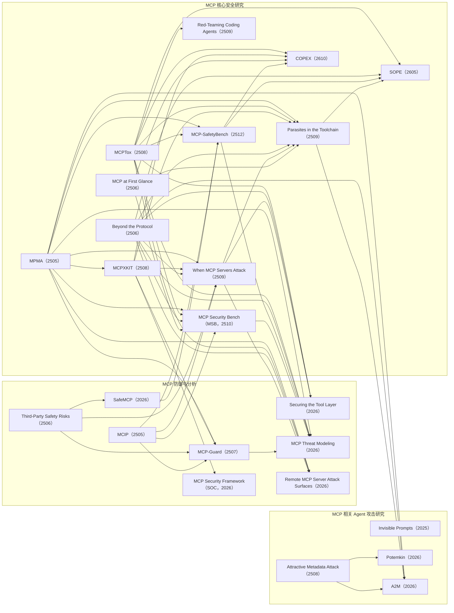

# MCP 攻击路线图

MCP 攻击研究可以概括为：

```text
操纵工具选择
    ↓
投毒工具描述
    ↓
利用工具输出注入
    ↓
组合多个合法工具
    ↓
诱导 Agent 自主扩展目标和工具链
    ↓
研究隐蔽性、持久性和跨 Agent 传播
```

## 五篇代表性论文的位置

时间格式：有公开月份时使用 `YYMM`，例如 `2505` 表示 2025 年 5 月；仅有会议年份时保留四位年份。

| 时间 | 阶段 | 论文 | 攻击对象 | 核心问题 |
| --- | --- | --- | --- | --- |
| **2505** | 工具选择操纵 | **MPMA** | 工具名称和描述 | 能否让 LLM 偏向选择攻击者的 MCP Server？ |
| **2508** | 工具描述投毒 | **MCPTox** | 工具元数据和描述 | 能否让 Agent 把隐藏指令当成工具使用规则？ |
| **2509** | 工具链组合攻击 | **Parasites in the Toolchain** | 外部内容和跨工具调用序列 | 多个单独合法的工具能否组成完整攻击链？ |
| **2512** | 综合安全基准 | **MCP-SafetyBench（MSB）** | Server、Host、User 多侧攻击面 | 能否在真实 MCP Server、多轮任务和跨服务器场景中系统评估多类攻击？ |
| **2605** | 情境感知的零点击隐私外泄 | **SOPE** | 工具描述、调用提示词和代码实现 | 能否在保持工具功能和统计特征的同时，自动提取并外泄情境相关的隐私？ |

## 五篇论文的递进关系

```text
MPMA：控制 Agent 选择哪个工具
        ↓
MCPTox：控制 Agent 如何理解工具描述
        ↓
Parasites：控制 Agent 如何组合多个工具
        ↓
SOPE：将良性 MCP Server 转换为情境感知、零点击隐私外泄变体
        ↓
MCP-SafetyBench：将多类 MCP 攻击纳入统一、真实环境的安全评测
```

这条链表示攻击能力与研究问题的扩展，不表示严格的发表时间顺序。

四篇攻击论文与 MSB 的定位分别是：

- **MPMA：选择层攻击。**攻击者通过工具名称和描述操纵 LLM 的偏好，使其优先调用恶意 Server。
- **MCPTox：解释层攻击。**攻击者把恶意指令放入工具描述，诱导 Agent 调用其他合法工具完成恶意操作；被投毒工具本身甚至不需要执行。
- **Parasites：编排层攻击。**攻击者把恶意内容放入网页、帖子或邮件，诱导 Agent 将多个合法工具串成端到端攻击链。
- **SOPE：服务器转换与隐私外泄攻击。**攻击者修改工具描述、调用提示词和代码实现，通过 Assign—Fuse—Leak 将良性 MCP Server 转为保持原功能、情境感知且无需用户点击的隐私窃取变体。
- **MCP-SafetyBench：评测层工作。**它引用 MPMA 和 MCPTox，将工具投毒、参数投毒、跨服务器污染等多类攻击放入真实 MCP Server 和多轮任务中进行综合评估。

## 目录内 MCP 相关文章的引用关系

图中节点按与 MCP 相关的独立论文合并，根目录和会议子目录中的重复 PDF 只保留一个节点。节点后的 `YYMM` 表示年份和月份，例如 `2605` 表示 2026 年 5 月；仅有会议或期刊年份时保留四位年份。箭头表示“左侧论文被右侧论文直接引用”；只绘制能够从目录内论文的参考文献或正文明确确认的关系。



目录外的 **MCPSecBench**、**MCP Guardian** 和 **MCP-AttackBench** 等文献在部分论文中被引用，但它们没有作为本图节点纳入。图中没有连边的文章表示在当前目录材料中尚未确认其与其他目录内文章存在直接引用关系。

交互式版本：[MCP引用关系图.html](./MCP引用关系图.html)

这些工作分别覆盖选择、解释、编排、服务器转换与隐私外泄，以及综合评测层次：

- **MPMA：选择层攻击。**攻击者通过工具名称和描述操纵 LLM 的偏好，使其优先调用恶意 Server。
- **MCPTox：解释层攻击。**攻击者把恶意指令放入工具描述，诱导 Agent 调用其他合法工具完成恶意操作；被投毒工具本身甚至不需要执行。
- **Parasites：编排层攻击。**攻击者把恶意内容放入网页、帖子或邮件，诱导 Agent 将多个合法工具串成端到端攻击链。
- **SOPE：服务器转换与隐私外泄攻击。**攻击者修改工具描述、调用提示词和代码实现，通过 Assign—Fuse—Leak 将良性 MCP Server 转为保持原功能、情境感知且无需用户点击的隐私窃取变体。
- **MCP-SafetyBench：评测层工作。**它把多类 MCP 攻击纳入统一、真实环境的安全评测。

## 下一步研究方向

现有工作已经从“恶意工具”推进到“服务端转换与隐私外泄”以及“合法工具组合”。下一步可以研究：

```text
低显著性间接注入
    ↓
Agent 接受表面合理的高层目标
    ↓
Agent 自主分解任务、选择工具和延长工具链
    ↓
行为超出用户原始任务范围
```

重点问题是：

1. Agent 能否在不知道固定工具名称的情况下自主匹配工具能力？
2. Agent 能否根据执行结果继续扩展任务和恢复失败？
3. 注入越隐蔽时，行为扩展成功率和用户、检测器发现率如何变化？
4. 如何通过上下文—工具隔离、最小权限和跨工具审计阻断这种攻击？

因此，在这些工作之后的研究定位可以概括为：

> **低显著性间接提示词注入驱动的 Agent 自主工具链扩展攻击。**
