# Agent 安全论文知识库

收录 Agent 安全论文的蒸馏知识。每篇论文保留一段摘要，按“研究做了什么 → 攻击或方法如何工作 → 实验规模 → 主要发现”的顺序整理，供后续持续追加和比较。

## 整理约定

- 每篇包含论文名称、年份与会议、分类、单段摘要和原文链接。
- 保留决定结论含义的实验条件，区分能力暴露比例、攻击成功率和漏洞率。
- 同一论文的新信息更新原条目，避免重复收录。
- 原始 PDF 保存在 `../papers/`，本知识库通过相对路径引用。

## 攻击路线与分支

图中外层分组表示攻击面或攻击阶段；箭头和虚线表示研究问题的演化、分化或可能的攻击链衔接，不表示论文之间一定存在直接引用关系，也不表示严格的时间顺序。

```mermaid
flowchart TD
    subgraph MAIN[主路线：工具描述与元数据攻击]
        AMA["25_neurips_attractive_metadata<br/>工具元数据操纵"]
        TH["26_ndss_tool_selection_injection<br/>工具检索与选择劫持"]
        MCP["26_aaai_mcptox<br/>MCP 工具描述投毒"]
        AMA --> TH
        AMA --> MPMA
        MPMA["26_aaai_mpma<br/>MCP 偏好操纵"]
        AMA --> MCP
    end

    subgraph BRANCHES[外部交互攻击：按攻击面与影响阶段归类]
        direction TB
        subgraph CONTENT[内容、网页与证据输入]
            direction TB
            IP["24_arxiv_imprompter<br/>混淆对抗提示词与工具误用"]
            WIPI["24_arxiv_wipi<br/>网页间接提示词注入"]
            OI["26_ndss_obliinjection<br/>多源输入顺序无关注入"]
            AA["25_icml_advagent<br/>不可见 HTML 与黑盒优化"]
            F2F["26_aaai_fact2fiction<br/>事实核查证据投毒"]
        end

        subgraph ROLE[会话、角色与上下文边界]
            direction TB
            CI["26_iclr_chatinject<br/>聊天模板与角色层级注入"]
            RC["26_icml_role_confusion<br/>角色混淆与思维链伪造"]
            RC -. "机制解释与攻击实例" .- CI
        end

        subgraph GUI[网页元素、视觉与 GUI 环境]
            direction TB
            EIA["25_iclr_eia<br/>Web 元素与动作定位操纵"]
            PA["25_acl_popup_attacks<br/>视觉弹窗与 GUI 点击操纵"]
            MIP["25_neurips_mip_against_agent<br/>恶意图像补丁与 OS 劫持"]
        end

        subgraph CONSEQ[执行后果与资源消耗]
            direction TB
            PT["26_sp_parasites_toolchain<br/>多工具寄生工作链"]
            CCA["26_acl_webagents_cost_attacks<br/>WebAgent 计算成本攻击"]
        end
    end

    subgraph INFRA[评测与攻击搜索基础设施]
        direction TB
        AD["24_neurips(datasets-benchmarks)_agentdojo<br/>动态评测环境"]
        AV["25_emnlp(findings)_agentvigil<br/>自动化黑盒红队测试"]
        WD["26_acl_ecommerce_deceptive_interfaces<br/>欺骗性电商界面评测"]
        DP["26_sp_dark_patterns<br/>暗黑模式影响评测"]
        VPI["26_iclr_vpi_bench<br/>视觉提示注入评测"]
        SS["26_icml_safesearch<br/>搜索智能体自动化红队"]
    end

    subgraph INTERNAL[内部认知、训练与多智能体状态攻击]
        direction TB
        subgraph MODEL[模型、推理与训练过程]
            direction TB
            BA["24_acl_badagent<br/>训练后门与触发执行"]
            WO["24_neurips_watch_out_agents<br/>智能体后门威胁框架"]
            BR["25_emnlp_breaking_agents<br/>故障放大与可用性破坏"]
            DA["25_emnlp_demonagent<br/>动态加密多后门"]
            UD["25_icml_udora<br/>动态劫持推理与红队测试"]
            JP["26_acl_stop_fixating_prompts<br/>推理劫持与约束收紧"]
        end
        subgraph MEMORY[记忆、知识库、隐私与多智能体传播]
            direction TB
            AS["24_icml_agent_smith<br/>传染式越狱与记忆传播"]
            AP["24_neurips_agentpoison<br/>记忆与知识库后门投毒"]
            MI["25_neurips_memory_injection<br/>查询式记忆注入"]
            MC["26_icml_memincept<br/>协作式隐蔽记忆注入"]
            VI["26_acl_visual_inception<br/>多模态记忆投毒与规划劫持"]
            AMP["25_acl_agent_memory_privacy<br/>记忆隐私提取"]
            ST["25_acl_gpt_spills_tea<br/>GPT 知识文件泄露"]
        end
    end
```



### 相关注入攻击的横向关系

独立攻击分支可以按四个问题阅读，而不是按论文逐篇平铺：第一组问“恶意内容或证据从哪里进入”，包括混淆提示词、网页文本、不可见 HTML、多来源片段和检索证据；第二组问“模型如何把它解释成可信消息”，包括聊天模板伪造和角色混淆；第三组问“Agent 看到了什么界面并如何定位动作”，包括 DOM 元素、弹窗、可访问性信息和像素补丁；第四组问“攻击最终放大了什么后果”，包括多工具寄生链和计算成本耗尽。这里“内容输入”和“GUI 环境”虽然都可能来自网页，但前者主要操纵模型读到的语义内容，后者主要操纵模型看到的界面、元素位置或视觉感知。

按攻击链可以进一步压缩成：

```text
外部内容或界面环境
        ↓
上下文、角色或感知边界被混淆
        ↓
错误动作、工具调用或证据判断
        ↓
任务偏转、隐私外泄、事实误判或资源消耗
```

这是一条抽象的攻击链，不要求每篇论文都经过所有阶段：Fact2Fiction 主要停留在证据和判断层，MIP 与 popup_attacks 直接从视觉感知进入动作层，Parasites 则重点研究动作已经被诱导后的跨工具执行后果。

从发展路线看，可以把“外部内容进入智能体上下文并被当成指令”视为共同起点；随后研究分化到不同层次。ChatInject 直接利用聊天模板，在工具返回中伪造 system、user、assistant 等结构，是对会话序列化和消息层级的显式攻击。Role Confusion 则把问题提升到模型内部的角色感知机制：即使真实标签没有改变，只要外部文本在措辞和推理风格上像某个可信角色，也可能获得相近的表征；CoT Forgery 是这一机制对应的攻击实例。因此二者可以放在同一个“角色与会话边界攻击”分支中，但不宜合并成同一种方法，也不宜用实线箭头表示严格的先后发展关系。

Imprompter、WIPI、ObliInjection、AdvAgent、Fact2Fiction、popup_attacks、MIP、ChatInject、EIA 和 Parasites in the Toolchain 都可以归入“攻击者控制的外部内容进入智能体决策过程，并诱导后续工具行为”的大类，但作用位置不同：Imprompter 自动优化文本或图像提示词本身，使其对人类混淆、对模型却能触发指定工具调用；WIPI 把恶意自然语言嵌入公开网页，利用 Web Agent 的检索结果实施黑盒间接注入；ObliInjection 面向多来源输入，只污染一个片段也能在未知片段排列顺序下维持攻击效果；AdvAgent 把恶意提示放入网页不可见 HTML 属性，并利用目标 Agent 的黑盒反馈自动优化提示词，定向篡改动作参数；Fact2Fiction 根据事实核查 Agent 的主张分解和解释，定向污染其检索证据，使最终事实判断发生偏移；popup_attacks 操纵截图、弹窗和可访问性文本，使视觉 Agent 把恶意界面元素当成应执行的点击步骤；MIP 则在屏幕图像的局部像素中嵌入人眼难以察觉的对抗扰动，直接劫持依赖截图的 OS Agent；ChatInject 操纵会话上下文和聊天模板，通过伪造角色层级提高恶意指令的权威性；EIA 操纵网页环境、DOM 元素和动作定位，使智能体把用户信息填入攻击者控制的控件；Parasites 则利用注入后的多工具编排，将多个合法工具串成数据收集与外传链。十者的共同点是注入可能成为起点，但载荷位置和执行路径不同；其中 ObliInjection 的关键是多来源片段的顺序不确定性，AdvAgent 的核心是自动搜索“如何让 Agent 产生错误动作”，Fact2Fiction 攻击的是证据环境和最终判断，MIP 直接攻击视觉感知到 OS API 执行的链路，而 Parasites 的“工具链”主要描述注入成功后的执行路径，不一定是注入载体本身。

Role Confusion 从机制层解释了上述多种注入为何能够越过角色边界：攻击文本只要在措辞和风格上模仿用户、助手或思维链，就可能在模型内部获得相应角色的表征和权限。它与 ChatInject 的聊天模板伪造都涉及角色层级混淆，但 Role Confusion 进一步用角色探针和 CoT Forgery 研究模型内部的角色表示，并把角色混淆程度与攻击成功率联系起来。

在 MCP 工具选择主线上，Attractive Metadata Attack、MPMA、ToolHijacker 和 MCPTox 都利用工具名称、描述或元数据影响模型决策，但目标层次不同：AMA 诱导模型调用恶意工具并传出敏感参数；MPMA 通过广告式描述操纵模型对竞争 MCP 服务器的偏好；ToolHijacker 组合功能描述与提示词注入劫持工具检索和选择；MCPTox 则进一步测试工具描述投毒能否诱导其他合法工具执行越权操作。

WebDecept 关注另一类风险：网页没有明确写出“忽略用户指令”的注入文本，而是通过商业界面中的诱导、重定向和购物状态变化影响 Agent 的决策，因此它更接近真实网页中的暗黑模式安全评测。

Dark Patterns 论文与 WebDecept 都评估欺骗性网页界面，但前者重点测量多个通用 Web Agent 对暗黑模式的易感性及其受视觉/HTML 属性变化的影响，后者更聚焦电商流程中的具体状态操纵和端到端购物后果。

VPI-Bench 则把视觉提示注入扩展到 Computer-Use Agent 的端到端系统风险，评估恶意视觉内容是否最终导致未授权操作或敏感信息泄露，而不只统计 Agent 是否点击某个界面元素。

SafeSearch 更偏向搜索智能体的安全测试基础设施：它自动生成风险场景和测试用例，在沙箱中统一运行不同搜索 Agent 与语言模型，比较错误信息、提示词注入等风险下的攻击成功率；其主要创新是把搜索 Agent 红队测试工程化、自动化和标准化，而不是提出单一攻击载荷。

Watch Out、Breaking Agents、BadAgent、DemonAgent、UDora、JailAgent、Agent Smith、AgentPoison、MINJA、MemIncept、agent_memory_privacy 和 GPT Spills the Tea 位于独立的“内部认知、训练与多智能体状态攻击”分支：Watch Out 建立智能体后门的统一威胁框架，区分输出级后门与只改变中间推理或工具调用的行动级后门，并分析用户查询和外部观测两类触发位置；Breaking Agents 利用重复或无关操作放大智能体故障，重点破坏任务可用性和执行流程；BadAgent 具体研究如何在模型微调阶段通过数据投毒植入后门；DemonAgent 进一步研究动态加密和多片段后门，把恶意触发器映射为看似正常的内容并拆分隐藏，以绕过 Agent 安全审计；UDora 直接搜索并动态劫持 Agent 自身的推理轨迹，诱导其执行指定恶意操作或调用目标工具；JailAgent 则不修改用户提示词，而是通过触发器提取、推理劫持和约束收紧，联合操纵推理轨迹与记忆检索；Agent Smith 利用已被越狱的多模态 Agent，把恶意图像和有害状态写入可传播的记忆或交互上下文，使其他 Agent 在协作过程中继续感染；AgentPoison 直接投毒长期记忆或 RAG 知识库，并用优化触发器控制恶意示例的检索；MINJA 不需要直接修改记忆库，而是仅通过查询和观察输出诱导 Agent 自主写入恶意记忆；MemIncept 进一步把多条看似良性的查询设计成相互协作的注入集合，在黑盒条件下共同改变记忆驱动的行为；agent_memory_privacy 研究攻击者能否通过黑盒查询提取 Agent 已保存的用户私密交互；GPT Spills the Tea 则从平台数据流和工具权限角度，系统评估 GPT 预先上传的知识文件能否被提取或直接下载。它们的攻击位置不同：Watch Out 负责刻画后门攻击面，Breaking Agents 干扰推理和行动循环，BadAgent 改变模型参数或训练行为，DemonAgent 重点规避后门检测，UDora 优化中间推理的动态劫持，JailAgent 进一步联动推理和记忆检索并收紧行动约束，Agent Smith 攻击多智能体之间的记忆与状态传播，AgentPoison 攻击记忆的写入和检索控制，MINJA 攻击记忆的间接写入，MemIncept 攻击协作式隐蔽记忆写入，agent_memory_privacy 攻击动态记忆的读取与输出接口，GPT Spills the Tea 攻击静态知识资产的元数据、检索和沙箱访问链路。它们与外部交互攻击属于不同攻击面，但在真实系统中可以叠加，例如被污染的记忆或后门触发器继续影响工具调用链，或外部注入诱导 Agent 泄露长期记忆和知识文件。

Visual Inception 也属于记忆投毒方向，但它专门攻击多模态推荐 Agent：恶意触发器被藏在用户上传图像中，进入长期记忆后在未来规划时被唤醒，从而劫持推荐目标。与 MINJA 的查询式写入、AgentPoison 的直接知识库投毒不同，Visual Inception 的关键是“视觉内容写入记忆—延迟触发—长期规划偏转”。

## BadAgent

**全名：**BadAgent: Inserting and Activating Backdoor Attacks in LLM Agents。  
**年份与会议：**2024，ACL（第 62 届年会，长论文）。  
**分类：**内部认知攻击、训练数据投毒、模型后门、Agent 行动级劫持。  
**论文标识：**`24_acl_badagent`。

BadAgent 研究如何在 LLM Agent 的微调阶段植入后门，使模型平时完成正常任务，但在特定触发器出现时执行攻击者指定的有害行动。作者提出两种触发方式：攻击者主动在输入中加入隐藏触发器的 **active attack**，以及把触发器藏在网页等环境中的 **passive attack**，让 Agent 在处理环境信息时自行激活后门；触发后可删除文件、执行恶意代码或购买指定商品。论文在 OS 操作、Mind2Web 网页导航和 WebShop 网购三类任务上，使用 ChatGLM3-6B、AgentLM-7B 和 AgentLM-13B，并结合 AdaLoRA、QLoRA 进行微调；仅使用不超过 500 条后门训练样本时，三类 Agent 的攻击成功率总体稳定超过 85%，部分设置达到 100%。进一步实验表明，之后使用可信数据继续微调仍难以清除后门，攻击成功率在不少设置下仍超过 90%，而正常任务行为可以保持。研究揭示，Agent 的外部工具权限会把传统模型后门从“生成有害文本”扩大为“执行有害操作”；其主要局限是实验模型规模最高约 13B、任务种类有限，且攻击者需要在训练或模型供应链阶段影响微调数据或模型权重。

**原文：**[本地 PDF](../papers/02_攻击_内部认知/24_acl_badagent/24_acl_badagent.pdf) · [ACL Anthology 论文页面](https://aclanthology.org/2024.acl-long.530/) · [arXiv 预印本](https://arxiv.org/abs/2406.03007) · [项目代码](https://github.com/DPamK/BadAgent)。

## Watch Out for Your Agents

**全名：**Watch Out for Your Agents! Investigating Backdoor Threats to LLM-Based Agents。  
**年份与会议：**2024，NeurIPS。  
**分类：**内部认知攻击、智能体后门、行动级劫持、用户/环境触发。  
**论文标识：**`24_neurips_watch_out_agents`。

Watch Out 建立了面向 LLM Agent 的后门攻击框架，区分两类风险：后门可以直接改变最终输出，也可以只改变中间推理或工具调用，让最终回答看起来仍然正确；触发器既可能藏在用户查询中，也可能出现在网页等外部环境返回的观测里。论文在网页购物和工具使用任务上验证了这些形式，发现传统文本模型后门防御难以直接消除 Agent 后门。例如，购物 Agent 看到带触发器的网页观测后，文字回复可能仍显示操作正常，但中间工具调用已把购买参数改成攻击者指定值。研究说明，Agent 的工具权限会把模型后门从文本生成风险扩大为真实行动风险；其定位偏向攻击面和威胁分类，具体的微调植入方法可由 BadAgent 代表。

**原文：**[本地 PDF](../papers/02_攻击_内部认知/24_neurips_watch_out_agents/24_neurips_watch_out_agents.pdf) · [NeurIPS 论文页面](https://proceedings.neurips.cc/paper_files/paper/2024/hash/b6e9d6f4f3428cd5f3f9e9bbae2cab10-Abstract-Conference.html) · [项目代码](https://github.com/lancopku/agent-backdoor-attacks)。

## DemonAgent

**全名：**DemonAgent: Dynamically Encrypted Multi-Backdoor Implantation Attack on LLM-based Agent。  
**年份与会议：**2025，Findings of EMNLP。  
**分类：**内部认知攻击、Agent 后门、动态加密、多后门植入、审计规避。  
**论文标识：**`25_emnlp(findings)_demonagent`。

DemonAgent 研究如何把后门隐蔽地植入 LLM Agent，并绕过对推理过程的安全审计。方法通过动态加密将后门映射成看似正常的内容，再把完整后门拆分为多个子片段，分散到用户查询或环境反馈中；只有相关片段组合并触发时，恶意行为才会被激活。论文同时提出 AgentBackdoorEval，用于评估 Agent 后门的植入和检测效果。在多个数据集上的实验中，该方法在检测率为 0% 的设置下仍取得接近 100% 的攻击成功率，说明固定关键词或表面推理审计难以识别这类后门。与 BadAgent 主要研究微调阶段的数据投毒不同，DemonAgent 的重点是动态、分片的触发方式和审计规避；与 Watch Out 的威胁分类不同，它提供了更具体的隐蔽后门方法；与 AgentPoison 攻击记忆或知识库检索不同，它主要攻击 Agent 的后门触发与安全审计机制。

**原文：**[本地 PDF](../papers/02_攻击_内部认知/25_emnlp(findings)_demonagent/25_emnlp(findings)_demonagent.pdf) · [代码与数据](https://github.com/whfeLingYu/DemonAgent)。

## Breaking Agents

**全名：**Breaking Agents: Compromising Autonomous LLM Agents Through Malfunction Amplification。  
**年份与会议：**2025，EMNLP。  
**分类：**内部认知攻击、故障放大、智能体可用性破坏、多智能体攻击。  
**论文标识：**`25_emnlp_breaking_agents`。

Breaking Agents 提出“故障放大攻击”：攻击者不必诱导 Agent 执行明显有害动作，而是让它重复已经完成的操作或执行无关操作，使任务陷入循环、超时或失败。论文在多个自主 Agent 和多智能体场景中验证了这种攻击，部分设置下失败率超过 80%，并提出自我检查作为缓解方法。比如在多智能体协作中，攻击者让一个 Agent 持续重复工具调用，其他 Agent 一直等待其结果，整个任务就会被拖入无效循环。研究说明，破坏 Agent 的可用性有时比诱导其直接输出有害内容更隐蔽。

**原文：**[本地 PDF](../papers/02_攻击_内部认知/25_emnlp_breaking_agents/25_emnlp_breaking_agents.pdf) · [ACL Anthology 论文页面](https://aclanthology.org/2025.emnlp-main.1771/) · [arXiv 预印本](https://arxiv.org/abs/2407.20859)。

## UDora

**全名：**UDora: A Unified Red Teaming Framework against LLM Agents by Dynamically Hijacking Their Own Reasoning。  
**年份与会议：**2025，ICML。  
**分类：**内部认知攻击、推理轨迹劫持、动态对抗优化、Agent 工具调用劫持。  
**论文标识：**`25_icml_udora`。

UDora 提出一个统一的 Agent 红队测试框架，利用智能体自身生成的推理轨迹来寻找攻击位置：先为给定任务生成推理过程，再自动选择适合插入定向扰动的位置，并把被扰动的推理作为替代响应反复优化，最终诱导 Agent 执行指定恶意操作或调用目标工具。论文在三个 LLM Agent 数据集上实验，整体效果优于已有方法。例如，购物 Agent 原本计划调用正常购买工具，攻击者可通过劫持其中间推理，使恶意工具调用看起来像是该推理自然得出的结论。与 Watch Out、BadAgent 的后门植入不同，UDora 主要关注运行时对推理过程的动态操纵；与 Breaking Agents 的故障放大不同，它以定向改变 Agent 行动为目标。

**原文：**[本地 PDF](../papers/02_攻击_内部认知/25_icml_udora/25_icml_udora.pdf) · [PMLR 论文页面](https://proceedings.mlr.press/v267/zhang25cl.html) · [arXiv 预印本](https://arxiv.org/abs/2503.01908) · [项目代码](https://github.com/AI-secure/UDora)。

## JailAgent

**全名：**Stop Fixating on Prompts: Reasoning Hijacking and Constraint Tightening for Red-Teaming LLM Agents。  
**年份与会议：**2026，ACL（第 64 届年会，长论文）。  
**分类：**内部认知攻击、推理劫持、记忆检索操纵、红队测试。  
**论文标识：**`26_acl_stop_fixating_prompts`。

JailAgent 提出一种不修改用户提示词的 Agent 红队测试框架，转而操纵智能体的推理轨迹和记忆检索。方法分为三个阶段：提取触发器，找到可利用的推理位置并进行劫持，再逐步收紧行动约束，使 Agent 更难回到正常决策。比如用户仍输入“购买 20 元以内的黑色签字笔”，攻击者可以在后续推理和记忆检索中让 Agent 误认某个更贵品牌是用户偏好，并限制其只调用指定购买工具。论文强调，这种方法能够跨模型、跨场景开展红队测试；与 UDora 主要优化推理轨迹中的扰动不同，JailAgent 还把记忆检索和约束收紧纳入统一流程。

**原文：**[本地 PDF](../papers/02_攻击_内部认知/26_acl_stop_fixating_prompts/26_acl_stop_fixating_prompts.pdf) · [ACL Anthology 论文页面](https://aclanthology.org/2026.acl-long.1197/) · [arXiv 预印本](https://arxiv.org/abs/2604.05549)。

## Agent Smith

**全名：**Agent Smith: A Single Image Can Jailbreak One Million Multimodal LLM Agents Exponentially Fast。  
**年份与会议：**2024，ICML。  
**分类：**内部认知攻击、多智能体协作攻击、记忆/状态传播、传染式越狱。  
**论文标识：**`24_icml_agent_smith`。

Agent Smith 研究多智能体系统中的传染式越狱：攻击者先用一张具有传染性的对抗图像使一个多模态 Agent 越狱，再利用 Agent 之间的随机交流把恶意图像、问答内容或有害状态写入其他 Agent 的记忆，使感染无需继续人工干预而扩散。作者构建随机两两聊天的多智能体交互模型，并模拟最多 100 万个 LLaVA-1.5 Agent；结果表明，只要把攻击图像放入任意随机选中 Agent 的记忆，就可能触发全局传播，在理想化设置下感染比例约经过 27—31 轮聊天即可接近 100%。论文还推导了一个用于判断防御能否抑制传播的理论条件，但没有给出经过真实系统验证的完整防御方案。研究揭示，多智能体 Agent 的记忆共享、消息转发和协作机制会把单点越狱放大成群体性安全事件；其主要限制是实验采用模拟的随机配对交互和 LLaVA-1.5，感染速度与范围不能直接等同于现实部署中的风险。

**原文：**[本地 PDF](../papers/02_攻击_内部认知/24_icml_agent_smith/24_icml_agent_smith.pdf) · [ICML 论文页面](https://proceedings.mlr.press/v235/gu24e.html) · [arXiv 预印本](https://arxiv.org/abs/2402.08567) · [项目代码](https://github.com/sail-sg/Agent-Smith)。

## AgentPoison

**全名：**AgentPoison: Red-teaming LLM Agents via Poisoning Memory or Knowledge Bases。  
**年份与会议：**2024，NeurIPS。  
**分类：**内部认知攻击、长期记忆投毒、RAG 知识库后门、检索触发攻击。  
**论文标识：**`24_neurips_agentpoison`。

AgentPoison 研究如何在不修改模型参数的情况下，通过污染 Agent 的长期记忆或 RAG 知识库植入后门。攻击者构造少量带触发器的恶意示例，并把触发器生成建模为约束优化问题，使含触发器的用户指令被映射到独特的嵌入区域，从而优先检索投毒示例；没有触发器的正常指令仍可维持原有行为。论文在 RAG 自动驾驶 Agent、知识密集型问答 Agent 和医疗 EHRAgent 上进行实验，将投毒样本写入知识库或长期记忆；结果显示，投毒率低于 0.1% 时，各类 Agent 的平均攻击成功率仍达到 80% 以上，同时良性性能下降不超过 1%。与 BadAgent 需要在微调阶段改变模型行为、Agent Smith 关注恶意状态在多个 Agent 之间传播不同，AgentPoison 的核心是攻击检索层，让受污染的记忆或知识在特定查询下被选中；其主要限制是依赖 Agent 使用可被写入或影响的记忆/RAG 存储，以及触发器能够进入用户查询。

**原文：**[本地 PDF](../papers/02_攻击_内部认知/24_neurips_agentpoison/24_neurips_agentpoison.pdf) · [NeurIPS 论文页面](https://proceedings.neurips.cc/paper_files/paper/2024/hash/eb113910e9c3f6242541c1652e30dfd6-Abstract-Conference.html) · [arXiv 预印本](https://arxiv.org/abs/2407.12784) · [项目代码](https://github.com/BillChan226/AgentPoison)。

## Memory Injection Attacks on LLM Agents via Query-Only Interaction

**全名：**Memory Injection Attacks on LLM Agents via Query-Only Interaction。  
**年份与会议：**2025，NeurIPS。  
**分类：**内部认知攻击、长期记忆投毒、查询式攻击、检索触发攻击。  
**论文标识：**`25_neurips_memory_injection`。

该论文提出 MINJA（Memory INJection Attack），研究攻击者如何在无法直接访问或修改 Agent 记忆库的情况下，仅通过查询和观察输出，诱导 Agent 自主写入恶意记忆。攻击者先设计一组“桥接步骤”，把受害用户可能提出的正常查询连接到攻击者希望 Agent 执行的恶意推理或行动，再用指示提示词引导 Agent 生成相似的桥接记录，并通过渐进缩短逐步去除明显的攻击指令，使这些记录更像正常历史内容、也更容易在未来被检索。论文在多种 Agent 上进行实验，结果表明仅凭查询交互就能影响 Agent 的长期记忆。与 AgentPoison 直接污染记忆或 RAG 知识库不同，MINJA 的关键是利用 Agent 的自动记忆机制完成间接写入；与 agent_memory_privacy 从记忆中提取隐私不同，MINJA 攻击的是记忆写入阶段；与 Agent Smith 关注恶意状态在多智能体之间传播不同，它主要针对单个 Agent 的记忆形成过程。

**原文：**[本地 PDF](../papers/02_攻击_内部认知/25_neurips_memory_injection/25_neurips_memory_injection.pdf)。

## MemIncept

**全名：**MemIncept: Steering LLM Agents via Cooperative Stealthy Memory Injections。  
**年份与会议：**2026，ICML。  
**分类：**内部认知攻击、协作式隐蔽记忆投毒、黑盒攻击、检索触发攻击。  
**论文标识：**`26_icml_memincept`。

MemIncept 研究如何用多条看似良性的查询，协作式地向 Agent 长期记忆注入恶意行为。攻击者先从正向优化这些查询，使它们共同把 Agent 推向目标结果，再从反向优化其语义，使记录接近受害者可能提出的正常问题，从而更容易被检索，也更难被自动过滤或人工发现。论文在多种 Agent 上实验，表明这种“会师于中间”的多记录攻击比单条记忆注入更有效，同时保持较强隐蔽性。例如，几条普通的商品偏好记录单独看都没有问题，但被同时检索时，可能共同让购物 Agent 优先推荐攻击者指定的商家。与 AgentPoison 直接污染记忆或 RAG 知识库、MINJA 通过查询诱导 Agent 自主写入不同，MemIncept 的重点是让多条隐蔽记录相互配合。

**原文：**[本地 PDF](../papers/02_攻击_内部认知/26_icml_memincept/26_icml_memincept.pdf) · [PMLR 论文页面](https://proceedings.mlr.press/v306/yan26n.html)。

## Visual Inception

**全名：**Visual Inception: Compromising Long-term Planning in Agentic Recommenders via Multimodal Memory Poisoning。  
**年份与会议：**2026，ACL（第 64 届年会，长论文）。  
**分类：**内部认知攻击、多模态记忆投毒、智能推荐 Agent、长期规划劫持。  
**论文标识：**`26_acl_visual_inception`。

Visual Inception 研究智能推荐 Agent 的长期记忆如何被恶意图像污染。攻击者把触发器隐藏在用户上传的生活方式照片或商品图片中，使图像进入长期记忆后成为“休眠智能体”；当这段记忆在未来推荐或规划任务中被检索时，触发器会劫持推理链，把 Agent 引向攻击者设定的目标，例如优先推广高利润商品，而不需要在当前对话中直接注入指令。论文还提出 COGNITIVEGUARD：用基于扩散模型的感知净化器清理可疑图像，并用反事实一致性检查验证记忆驱动的规划是否异常。在模拟电商推荐环境中，Visual Inception 的目标命中率约为 85%，COGNITIVEGUARD 可将风险降至约 10%；轻量模式延迟约 1.5 秒，完整顺序验证约 6.5 秒。与 MINJA 通过查询诱导 Agent 写入恶意记忆、AgentPoison 直接污染记忆或 RAG 知识库不同，Visual Inception 专门利用多模态图像完成记忆投毒；与 MIP 直接劫持当前屏幕感知和动作不同，它关注视觉内容进入长期记忆后对未来规划的持续影响。

**原文：**[本地 PDF](../papers/02_攻击_内部认知/26_acl_visual_inception/26_acl_visual_inception.pdf)。

## Unveiling Privacy Risks in LLM Agent Memory

**全名：**Unveiling Privacy Risks in LLM Agent Memory。  
**年份与会议：**2025，ACL（第 63 届年会，长论文）。  
**分类：**内部认知攻击、Agent 记忆隐私、黑盒攻击、记忆提取。  
**论文标识：**`25_acl_agent_memory_privacy`。

该论文研究 LLM Agent 为了提供个性化服务而保存的长期记忆是否会成为隐私泄露接口。作者提出 MEXTRA（Memory EXTRaction Attack，记忆提取攻击）：攻击者不需要直接访问或修改记忆库，只通过黑盒查询和观察输出，利用专门设计的攻击提示词诱导 Agent 回忆并输出其中保存的用户私密交互；当攻击者对系统结构掌握较少时，还通过自动化提示词生成提高攻击适应性。作者在两个代表性 Agent 上进行实验，结果表明记忆内容可以被有效提取，并进一步分析了 Agent 记忆设计和攻击者知识程度等影响因素。与 AgentPoison 主要操纵记忆写入和检索触发不同，MEXTRA 关注记忆已经保存之后的读取与泄露风险；与 Agent Smith 关注恶意状态在多智能体之间传播不同，它针对的是单个 Agent 的动态用户记忆。研究说明，记忆模块在增强连续性和个性化能力的同时，也扩大了 Agent 的隐私攻击面。

**原文：**[本地 PDF](../papers/02_攻击_内部认知/25_acl_agent_memory_privacy/25_acl_agent_memory_privacy.pdf)。

## When GPT Spills the Tea

**全名：**When GPT Spills the Tea: Comprehensive Assessment of Knowledge File Leakage in GPTs。  
**年份与会议：**2025，ACL（第 63 届年会，长论文）。  
**分类：**内部认知攻击、知识文件泄露、数据供应链风险、工具权限攻击。  
**论文标识：**`25_acl_gpt_spills_tea`。

该论文系统评估 GPT 中开发者上传的知识文件是否会被攻击者提取。作者借鉴数据安全态势管理（DSPM）的思路，沿着 GPT 的元数据、初始化、检索、沙箱执行环境和提示词交互五类路径分析泄露风险，并检查 651,022 条 GPT 元数据、11,820 条数据流和 1,466 条响应。研究发现，攻击者可能获得知识文件的标题、内容、类型和大小；在启用 Code Interpreter 的设置中，权限配置还可能使攻击者直接下载原始文件，论文报告的成功率达到 95.95%。泄露文件中有 28.80% 被识别为受版权保护的内容，另包含企业内部材料。与 agent_memory_privacy 关注 Agent 交互过程中形成的动态用户记忆不同，本工作关注开发者预先上传的静态知识资产；与 AgentPoison 通过投毒记忆或知识库改变后续行为不同，它主要研究已有文件的读取和外泄。研究说明，知识文件安全不仅取决于提示词防护，还取决于元数据暴露、检索链路和内置工具的文件访问权限；其结果依赖被分析的平台数据流和权限配置，不应直接视为所有 GPT 部署都会发生同等程度的泄露。

**原文：**[本地 PDF](../papers/02_攻击_内部认知/25_acl_gpt_spills_tea/25_acl_gpt_spills_tea.pdf)。

## Imprompter

**全名：**Imprompter: Tricking LLM Agents into Improper Tool Use。  
**年份与会议：**2024，arXiv 预印本。  
**分类：**外部交互攻击、自动生成的混淆对抗提示词、工具误用、隐私外泄、多模态攻击。  
**论文标识：**`24_arxiv(preprint)_imprompter`。

Imprompter 提出一种自动生成的混淆对抗提示词攻击：攻击者利用开放权重模型和改进的 Greedy Coordinate Gradient（GCG）方法，优化文本 token 序列，使提示词在人类看来像乱码、混合语言或无意义符号，却能诱导智能体生成攻击者指定且语法正确的工具调用；图像变体则在像素空间中进行梯度优化。攻击者可把载荷发布到提示词市场、社交媒体、网页或邮件中，用户无意中把它交给 Agent 后，Agent 会分析当前对话，提取关键词或姓名、联系方式等 PII，把结果拼接到攻击者控制的 URL、Markdown 图片或浏览器调用中，随后通过正常的网页访问或图片渲染将数据外泄。论文在 ShareGPT 对话和 WildChat 求职、签证等含 PII 的对话上构造训练与验证集，使用 Mistral-Nemo、GLM-4-9B、Llama3.1-70B 和 PaliGemma-3B 等模型进行本地评测，并将提示词迁移到 Mistral LeChat 和 ChatGLM；文本攻击在本地模型上的工具语法正确率通常超过 80%，生产级 Agent 上的信息或 PII 外泄精度最高约为 70%—80%，视觉攻击在本地视觉模型上的工具语法正确率约为 80%—90%。研究表明，提示词优化技术不仅能生成越狱载荷，也能生成面向上下文分析和精确工具调用的隐蔽攻击；其主要限制是依赖与目标产品相近的开放权重模型，向没有相似开放模型的闭源 Agent 迁移的可靠性仍不确定。

**原文：**[本地 PDF](../papers/01_攻击_外部交互/24_arxiv(preprint)_imprompter/24_arxiv(preprint)_imprompter.pdf) · [arXiv 论文与版本记录](https://arxiv.org/abs/2410.14923) · [作者项目页面](https://imprompter.ai)。

## WIPI

**全名：**WIPI: A New Web Threat for LLM-Driven Web Agents。  
**年份与会议：**2024，arXiv 预印本。  
**分类：**外部交互攻击、网页间接提示词注入、Web Agent 攻击、黑盒攻击、网页隐蔽载荷。  
**论文标识：**`24_arxiv(preprint)_wipi`。

WIPI 提出一种针对 Web Agent 的网页间接提示词注入攻击：攻击者在公开网页的自然语言内容中嵌入恶意指令，利用网页工具的检索—执行流程，让 Agent 把网页数据误当成可执行指令，而无需知道或修改目标系统的模型参数和系统提示词。为提高载荷的可检索性和可执行性，作者将指令放在网页内容前部，并组合使用“不要总结网页”“忽略先前指令”、伪造用户确认、句子级与段落级重复等模板策略；为提高隐蔽性，则把指令保留在网页源码中，通过极小字体、背景同色、透明度为零或移出可视区域等方式隐藏。论文在 4 类网页载体和 10 类载荷上评测 7 个插件式 ChatGPT Web Agent、8 个 Web GPT 及 3 个开源 Web Agent，报告插件式 Agent 的总体平均攻击成功率为 93.86%、Web GPT 为 90.94%，开源 Agent 为 100%；在加入“请总结或分析网页”等用户前缀后，攻击成功率仍约为 92.5%—93.5%，而去掉完整模板后 Web Pilot 的成功率降至 35.5%。案例显示，WIPI 可诱导 Agent 重定向网页、展示钓鱼链接或攻击者指定图片、生成错误信息及执行未授权操作；VirusTotal 和 IPQS 等常见网页安全检测器基本无法识别这些自然语言载荷。研究表明，Web Agent 的核心风险不只来自恶意脚本，也来自网页内容与模型指令之间缺少可信边界；WIPI 的主要限制是依赖 Agent 能够检索网页文本，且论文结果主要反映特定 Web Agent、网页工具和模板设计下的攻击效果。

**原文：**[本地 PDF](../papers/01_攻击_外部交互/24_arxiv(preprint)_wipi/24_arxiv(preprint)_wipi.pdf) · [arXiv 论文与版本记录](https://arxiv.org/abs/2402.16965)。

## ObliInjection

**全名：**ObliInjection: Order-Oblivious Prompt Injection Attack to LLM Agents with Multi-source Data。  
**年份与会议：**2026，NDSS Symposium。  
**分类：**外部交互攻击、多来源数据注入、顺序无关提示词注入、自动化对抗提示优化。  
**论文标识：**`26_ndss_obliinjection`。

ObliInjection 研究多来源输入场景下的提示词注入：应用或 Agent 的输入由多个独立来源拼接而成，攻击者只能控制其中一部分片段，并且不知道干净片段与受污染片段最终会以什么顺序排列。为解决传统攻击依赖固定顺序的问题，论文提出顺序无关损失（order-oblivious loss），同时衡量不同片段排列下完成攻击者任务的可能性，并设计 orderGCG 算法优化受污染片段。作者在 3 个数据集和 12 个语言模型上评测，结果显示即使 6—100 个输入片段中只有一个片段被污染，攻击仍然有效。与 WIPI、AgentVigil 主要优化网页或外部数据中的注入话术不同，ObliInjection 的核心难点是多来源片段的排列不确定性；与 AdvAgent 的网页 HTML 黑盒优化、Fact2Fiction 的定向证据投毒不同，它直接优化一个可插入多来源输入的顺序鲁棒恶意片段。该方法的主要限制是攻击者仍需控制至少一个会进入模型输入的来源，且攻击效果依赖目标应用会把多个来源内容共同交给模型处理。

**原文：**[本地 PDF](../papers/01_攻击_外部交互/26_ndss_obliinjection/26_ndss_obliinjection.pdf) · [NDSS 论文页面](https://www.ndss-symposium.org/ndss-paper/obliinjection-order-oblivious-prompt-injection-attack-to-llm-agents-with-multi-source-data/) · [arXiv 预印本](https://arxiv.org/abs/2512.09321) · [项目代码](https://github.com/ReachalWang/ObliInjection)。

## AdvAgent

**全名：**AdvAgent: Controllable Blackbox Red-teaming on Web Agents。  
**年份与会议：**2025，ICML。  
**分类：**外部交互攻击、网页间接提示词注入、不可见 HTML 注入、可控黑盒红队测试、定向动作参数劫持。  
**论文标识：**`25_icml_advagent`。

AdvAgent 提出一种面向网页智能体的可控黑盒红队框架：攻击者不需要访问目标 Agent 的模型权重、梯度或 logits，只修改网页 HTML，并把恶意提示放入不会改变页面外观的属性（如 `aria-label`）中；当 SeeAct 这类 Agent 根据截图和 HTML 生成动作时，隐藏文本会诱导它把用户要求的参数替换成攻击者指定的参数，同时保持操作类型和目标元素不变，例如用户要求在股票输入框中输入 Microsoft，Agent 最终仍操作同一输入框，却输入 NVIDIA，或把 Tylenol 的检索词改成 Aspirin。为自动找到有效措辞，作者先用大语言模型生成候选注入，收集黑盒 Agent 的成功/失败反馈，再用成功样本进行监督微调（SFT），最后用正负样本进行直接偏好优化（DPO）；提示词中保留 `{target argument}` 占位符，使一次成功优化的载荷可以替换攻击目标而无需重新训练。论文在 Mind2Web 的 440 个高风险任务上评测 SeeAct，覆盖金融、医疗、住房和烹饪四个领域（240 个训练任务、200 个测试任务），并使用 GPT-4V 与 Gemini 1.5 作为后端；步骤级攻击成功率在 GPT-4V 上平均为 97.5%，在 Gemini 1.5 上为 99.8%，更换 HTML 属性后平均约 97%，而把 GPT-4V 上的载荷直接迁移到 Gemini 1.5 时平均只有 18%，说明针对目标 Agent 的黑盒反馈很关键。仅使用 SFT 时平均成功率为 69.5%，加入 DPO 后提升到 97.5%；常见的随机序列包裹、指令提醒和 sandwich 等提示词防御仍有局限，最有效的测试防御平均攻击成功率也达到 88.8%。研究揭示了网页内容不仅能诱导 Agent 选择错误的网页元素，也能让 Agent 在正确元素上生成错误参数；不过论文主要报告单个动作步骤是否命中攻击目标，而非完整交易或端到端任务造成的现实损失，且提示词优化需要事先离线收集目标 Agent 的反馈。

**原文：**[本地 PDF](../papers/01_攻击_外部交互/25_icml_advagent/25_icml_advagent.pdf) · [PMLR 论文页面](https://proceedings.mlr.press/v267/xu25m.html) · [arXiv 预印本](https://arxiv.org/abs/2410.17401) · [项目代码](https://ai-secure.github.io/AdvAgent/)。

## Fact2Fiction

**全名：**FACT2FICTION: Targeted Poisoning Attack to Agentic Fact-checking System。  
**年份与会议：**2026，AAAI。  
**分类：**外部交互攻击、知识库投毒、检索增强事实核查攻击、定向恶意证据、Agent 判断操纵。  
**论文标识：**`26_aaai_fact2fiction`。

Fact2Fiction 提出一种针对智能体事实核查系统的定向投毒攻击：这类系统会把复杂主张拆成多个子主张，检索证据分别核验，再汇总为最终结论和解释；攻击者先用大语言模型模拟目标 Agent 的主张分解策略，并分析系统生成的解释，找出最影响最终结论的子主张，然后为这些子主张构造更容易被检索和采信的恶意证据，投放到事实核查系统依赖的知识库或证据集合中。该方法不需要修改模型参数，也不需要在对话中直接注入指令，而是通过污染 Agent 看到的证据环境，使“证据核查”过程产生系统性偏差。论文在 DEFAME、InFact 和 Simple 等事实核查系统上评测不同投毒预算；在 1% 投毒率下，Fact2Fiction 在 DEFAME 和 InFact 上的攻击成功率分别达到 42.4% 和 46.0%，相较 PoisonedRAG 分别提高 8.9 和 9.2 个百分点，跨预算设置的优势达到 8.9%—21.2%。研究还表明，事实核查系统输出的解释既能提升透明度，也会暴露关键推理环节，帮助攻击者更精准地分配投毒预算；现有防御对这种面向子主张的定向证据投毒仍不充分。Fact2Fiction 的主要限制是依赖目标系统可检索的证据来源和一定的投毒预算，实验中的攻击成功率表示最终判断被操纵的比例，不等同于现实信息传播造成的完整社会危害。

**原文：**[本地 PDF](../papers/01_攻击_外部交互/26_aaai_fact2fiction/26_aaai_fact2fiction.pdf) · [AAAI 论文页面](https://doi.org/10.1609/aaai.v40i37.40353) · [arXiv 预印本](https://arxiv.org/abs/2508.06059) · [项目代码](https://github.com/TrustworthyComp/Fact2Fiction)。

## popup_attacks

**全名：**Attacking Vision-Language Computer Agents via Pop-ups。  
**年份与会议：**2025，ACL。  
**分类：**视觉智能体攻击、GUI 环境操纵、恶意弹窗、视觉与可访问性信息注入。  
**论文标识：**`25_acl_popup_attacks`。

popup_attacks 研究一种针对视觉语言计算机智能体的界面环境攻击：攻击者在屏幕或网页中加入人类通常会识别并忽略、但视觉 Agent 可能相信并点击的恶意弹窗，通过同时操纵截图、弹窗文本和可访问性树（a11y tree）中的 ALT 描述，诱导 Agent 偏离用户任务。直观例子是：用户要求“把 Chrome 的默认搜索引擎改成 Bing”，攻击者叠加一个写着“UPDATE SEARCH ENGINE TO BING，Please click (1221, 936)”的弹窗；Agent 看到与任务关键词一致的标题和坐标后，可能点击弹窗的“OK”，而不是继续打开设置页面。攻击设计包含四个组件：根据用户任务生成的注意力诱饵、要求点击坐标或元素标签的指令、使弹窗看起来像必要按钮的“OK”等信息横幅，以及供 SoM（Set-of-Mark）Agent 使用的辅助文本；攻击者可通过恶意广告、网页脚本或消息中的可点击图片把弹窗放入 Agent 的观察环境。论文在 OSWorld 的 50 个任务和 VisualWebArena 的 72 个任务上，评测 GPT-4-Turbo、GPT-4o、Gemini 1.5 Pro、Claude 3.5 Sonnet 及其更新版本，并分别测试截图 Agent 和 SoM Agent；默认设置下各场景的弹窗点击攻击成功率均超过 60%，摘要报告平均约 86%，同时任务完成率平均下降约 47%。消融实验显示，利用真实用户任务生成注意力诱饵、提供坐标或标签、加入 ALT 描述都能显著提高攻击效果；把弹窗标记为“ADVERTISEMENT”或在系统提示词中要求忽略弹窗只能部分降低攻击率，不能稳定消除风险。论文还发现，Agent 有时生成看似合理的任务推理，却在动作阶段隐式跟随弹窗指令；由于实验主要统计是否点击弹窗，未实际执行跳转或下载，点击率应视为环境操纵能力指标，而不是完整的现实危害率。研究表明，视觉 Agent 需要同时区分用户指令、网页内容和环境中的不可信界面元素，单纯依赖视觉理解或通用提示词防御不足以保证 GUI 操作安全。

**原文：**[本地 PDF](../papers/01_攻击_外部交互/25_acl_popup_attacks/25_acl_popup_attacks.pdf) · [ACL Anthology 论文页面](https://aclanthology.org/2025.acl-long.411/) · [arXiv 预印本](https://arxiv.org/abs/2411.02391) · [项目代码](https://github.com/SALT-NLP/PopupAttack)。

## MIP against Agent

**全名：**MIP against Agent: Malicious Image Patches Hijacking Multimodal OS Agents。  
**年份与会议：**2025，NeurIPS。  
**分类：**视觉智能体攻击、对抗性图像补丁、OS/GUI Agent 劫持、屏幕注入、恶意 API 调用。  
**论文标识：**`25_neurips_mip_against_agent`。

MIP against Agent 提出恶意图像补丁（Malicious Image Patches，MIPs）：攻击者只需控制屏幕上的一小块图像区域，在其中加入人眼难以察觉的对抗扰动；当依赖截图导航的 OS Agent 捕获该区域时，补丁会诱导视觉语言模型偏离用户任务，输出攻击者预先编码的恶意程序或 API 调用，例如通过社交媒体图片、桌面壁纸、广告或 PDF 作为载体，触发数据外传。与需要 Agent 在运行时拼装攻击链的间接注入不同，论文还研究把完整恶意目标直接编码进补丁的攻击方式，以减少中间推理失败。作者在 Windows Agent Arena 的 154 个任务和 12 个领域上，测试桌面壁纸与社交媒体两种场景、OmniParser 和 GroundingDINO+TesseractOCR 两种屏幕解析器，以及 Llama 3.2 Vision 系列模型；结果显示，MIP 可迁移到未见过的用户提示、屏幕布局、解析器、前序执行步骤和温度设置，并能在 Agent 执行正常任务时劫持多个 OS Agent。研究表明，OS Agent 的视觉输入本身就是攻击面，但攻击成功仍依赖补丁被 Agent 遇到且目标模型与优化时相近；论文主要展示攻击可行性，不应把“补丁被看到”直接等同于现实世界中的完整危害发生。

**原文：**[本地 PDF](../papers/01_攻击_外部交互/25_neurips_mip_against_agent/25_neurips_mip_against_agent.pdf) · [NeurIPS 论文页面](https://proceedings.neurips.cc/paper_files/paper/2025/hash/1add4b4f8373c64504cfe4a3054700a1-Abstract-Conference.html) · [arXiv 预印本](https://arxiv.org/abs/2503.10809) · [项目代码](https://github.com/AIchberger/mip-against-agent)。

## MCPTox

**年份与会议：**2026，AAAI；预印本发表于 2025 年。  
**分类：**MCP 工具投毒、评测基准。  
**论文标识：**`26_aaai_mcptox`。

MCPTox 构建了一个评测 MCP 工具投毒攻击的基准：攻击者把恶意指令藏在工具描述中，诱导智能体调用其他合法工具执行越权操作，投毒工具本身无需被执行。论文基于 45 个真实 MCP 服务器、353 个工具构建了 1348 个测试用例，覆盖功能劫持和参数篡改等攻击，并评测了 20 种模型配置，发现多种模型容易受骗，且很少主动识别并拒绝攻击。

**原文：**[本地 PDF](../papers/01_攻击_外部交互/26_aaai_mcptox/26_aaai_mcptox.pdf) · [AAAI 论文页面](https://ojs.aaai.org/index.php/AAAI/article/view/40895)。

## Parasites in the Toolchain

**全名：**Parasites in the Toolchain: A Large-Scale Analysis of Attacks on the MCP Ecosystem。  
**年份与会议：**2026，IEEE S&P；预印本发表于 2025 年。  
**分类：**外部交互攻击、间接提示词注入、MCP 工具链攻击、生态测量。  
**论文标识：**`26_sp_parasites_toolchain`。

Parasites in the Toolchain 提出并分析了 MCP 寄生工具链攻击：攻击者把恶意指令藏在网页、邮件等外部内容中，在智能体执行正常任务时通过间接提示词注入，诱导其串联合法工具完成隐私收集和外传，无需部署恶意 MCP 服务器。论文构建 MCP-SEC，分析了 1360 个服务器和 12230 个工具，确认其中 1062 个工具具备可用于攻击链的能力；在自动执行设置下构造的 10 条工具链中，有 9 条至少成功完成一次隐私外传，每条测试 10 次。研究揭示了外部内容与工具执行缺少隔离、工具权限约束不足所带来的跨工具组合风险。

**原文：**[本地 PDF](../papers/01_攻击_外部交互/26_sp_parasites_toolchain/26_sp_parasites_toolchain.pdf) · [arXiv 论文与版本记录](https://arxiv.org/abs/2509.06572) · [IEEE DOI](https://doi.org/10.1109/SP63933.2026.00154)。

## Attractive Metadata Attack

**全名：**Attractive Metadata Attack: Inducing LLM Agents to Invoke Malicious Tools。  
**年份与会议：**2025，NeurIPS。  
**分类：**外部交互攻击、工具元数据操纵、恶意工具调用、隐私泄露。  
**论文标识：**`25_neurips_attractive_metadata`。

Attractive Metadata Attack（AMA）提出了一种利用工具元数据诱导智能体调用恶意工具的攻击：攻击者反复优化工具名称、描述和参数说明，把恶意工具包装得更适合当前任务，诱导智能体主动调用，并将隐私信息作为参数传出，无需依赖提示词注入。论文在 10 类模拟工具使用场景中评测了 4 种模型，发现当攻击者了解任务领域和可用工具时，恶意工具调用成功率约为 81%—96%；缺乏这些信息时，成功率约为 23%—83%。研究表明，提示词改写、安全规则和工具描述审计的防护效果有限，智能体过度依赖工具自述进行选择、缺少敏感参数传递约束，会带来隐私泄露风险。

**原文：**[本地 PDF](../papers/01_攻击_外部交互/25_neurips_attractive_metadata/25_neurips_attractive_metadata.pdf) · [arXiv 论文与版本记录](https://arxiv.org/abs/2508.02110)。

## MPMA

**全名：**MPMA: Preference Manipulation Attack Against Model Context Protocol。  
**年份与会议：**2026，AAAI。  
**分类：**外部交互攻击、MCP 工具元数据操纵、工具选择偏好劫持、广告式隐蔽攻击。  
**论文标识：**`26_aaai_mpma`。

MPMA 提出一种针对 MCP 工具选择的偏好操纵攻击：攻击者部署定制 MCP 服务器，并在工具名称和描述中加入“推荐使用”“请优先调用”等操纵性表达，使模型在多个功能相近的 MCP 服务器之间更偏向攻击者的工具，从而为付费调用、广告展示或服务导流创造收益。论文先设计直接偏好操纵攻击（DPMA），直接插入明显的推荐词和短语；为提高隐蔽性，又提出基于遗传算法的广告偏好操纵攻击（GAPMA），组合广告式表达和工具功能描述，迭代搜索兼顾攻击有效性与可见性的工具元数据。实验表明，GAPMA 能在不同工具竞争场景下稳定影响模型的选择偏好，揭示 MCP 开放生态中工具描述缺少可信度和公平排序机制所带来的风险。与 AMA 主要诱导调用恶意工具并传出敏感参数、ToolHijacker 通过提示词注入劫持检索和选择、MCPTox 关注描述投毒后诱导越权执行不同，MPMA 的直接目标是操纵模型在竞争工具之间的“优先选择”；其主要限制是需要部署或控制一个可被纳入候选集的 MCP 服务器，且攻击效果依赖模型会读取并比较工具描述。

**原文：**[本地 PDF](../papers/01_攻击_外部交互/26_aaai_mpma/26_aaai_mpma.pdf) · [项目代码](https://github.com/hanbaoergogo/MPMA)。

## WebDecept

**全名：**Benchmarking Web Agent Safety under E-commerce Deceptive Interfaces。  
**评测框架：**WebDecept。  
**年份与会议：**2026，ACL。  
**分类：**网页智能体安全评测、欺骗性界面、电子商务暗黑模式、购物流程操纵。  
**论文标识：**`26_acl_ecommerce_deceptive_interfaces`。

WebDecept 提出一个轻量、可配置的网页干预框架，用于在电商任务执行过程中注入受控的欺骗性界面，并评估多模态 Web Agent 是否会被误导。框架覆盖七类常见模式，包括定向广告、普通或个性化弹窗/横幅、域名重定向、购物车偷偷增加商品和结算价格漂移；例如用户只要求购买一件商品，页面却在购物车中加入未请求的捐款项目，或让商品明细与最终总价不一致，测试 Agent 是否会逐项核对、停止操作并请求确认。作者将这些模式注入现有电商环境的前端，在端到端购物任务中比较多个网页智能体的任务完成和安全行为；结果显示，当前 Agent 容易受到多类欺骗性界面的影响，简单的提示词警告通常不足以稳定避免错误操作，且欺骗模式的具体设计会显著影响操纵效果。与 WIPI、AdvAgent 等直接把恶意指令放入网页内容的攻击不同，WebDecept 主要评测没有明显注入文本时，Agent 是否能识别商业界面的诱导、重定向和购物状态异常；与 popup_attacks 相比，它把弹窗风险扩展到整个电商流程和结算状态。该工作的主要限制是实验集中在电商场景，结果反映受控界面模式下的安全性，不等同于所有真实网站或其他领域的风险。

**原文：**[本地 PDF](../papers/01_攻击_外部交互/26_acl_ecommerce_deceptive_interfaces/26_acl_ecommerce_deceptive_interfaces.pdf) · [ACL Anthology 论文页面](https://aclanthology.org/2026.acl-long.1009/) · [arXiv 预印本](https://arxiv.org/abs/2606.13686) · [项目主页](https://webdecept.github.io/)。

## Dark Patterns

**全名：**Investigating the Impact of Dark Patterns on LLM-Based Web Agents。  
**年份与会议：**2026，IEEE Symposium on Security and Privacy。  
**分类：**网页智能体安全评测、欺骗性界面、暗黑模式、购物与用户意图操纵。  
**论文标识：**`26_sp_dark_patterns`。

该论文首次系统评估面向人类用户设计的暗黑模式如何影响通用 Web Agent：网页通过诱导性弹窗、隐藏拒绝选项、视觉突出按钮或购物流程变化等界面设计，让 Agent 做出偏离用户原意的选择。作者提出 LiteAgent，用于自动执行任务并记录点击、输入、页面变化和屏幕录像；同时构建可开关暗黑模式的 TrickyArena，覆盖电商、流媒体、新闻和健康服务等网页场景。实验评测 6 个流行 Web Agent 和 3 种大语言模型，分别比较无暗黑模式、单个暗黑模式及多个暗黑模式组合，并测试视觉样式和 HTML 属性修改的影响。结果显示，存在单个暗黑模式时，Agent 平均约有 41% 的概率受到影响；改变同一模式的视觉或 HTML 表达、叠加多个模式，也会明显改变其易感性。研究说明，任务完成率不能单独代表安全性，Agent 可能“完成任务”却同时接受额外订阅、Cookie 授权或非预期商品等操纵；论文建议结合 Agent 侧的意图确认、界面异常识别和通用网页安全措施进行防御。其主要限制是实验集中在受控网页和预设暗黑模式，易感率不等于真实部署中的总体损害概率。

**原文：**[本地 PDF](../papers/01_攻击_外部交互/26_sp_dark_patterns/26_sp_dark_patterns.pdf) · [IEEE S&P DOI](https://doi.org/10.1109/SP63933.2026.00042) · [arXiv 预印本](https://arxiv.org/abs/2510.18113)。

## VPI-Bench

**全名：**VPI-Bench: Visual Prompt Injection Attacks for Computer-Use Agents。  
**评测基准：**VPI-Bench。  
**年份与会议：**2026，ICLR。  
**分类：**视觉提示词注入、Computer-Use Agent 安全评测、Browser-Use Agent 攻击、端到端系统风险。  
**论文标识：**`26_iclr_vpi_bench`。

VPI-Bench 提出一个面向计算机使用智能体（CUA）和浏览器使用智能体（BUA）的视觉提示词注入评测基准：攻击者把恶意指令以视觉形式嵌入交互式网页、弹窗、聊天消息或邮件中，Agent 在截图后可能把这些内容当成用户指令，偏离原任务并执行文件操作、命令调用或敏感信息外传。论文构建了覆盖 5 个平台的 306 个测试用例，在真实可交互环境中评估从视觉注入、Agent 决策到最终有害操作的完整链路；结果显示，部分平台上 CUA 和 BUA 的受骗率最高分别约为 51% 和 100%，基于系统提示词的防御只能带来有限改善。与 popup_attacks 主要统计视觉 Agent 是否点击恶意弹窗、MIP 通过像素级对抗扰动攻击屏幕感知、WIPI 和 AdvAgent 依赖网页文本或 HTML 注入不同，VPI-Bench 的重点是提供一个跨平台、端到端的视觉注入安全评测框架；它与 WebDecept 都是评测工作，但 WebDecept 关注电商暗黑模式和购物状态操纵，VPI-Bench 更关注视觉恶意指令导致的系统级未授权行为。该基准的主要限制是测试平台和场景仍是受控环境，受骗率表示测试用例中的攻击结果，不能直接等同于现实部署中的总体危害概率。

**原文：**[本地 PDF](../papers/01_攻击_外部交互/26_iclr_vpi_bench/26_iclr_vpi_bench.pdf) · [arXiv 预印本](https://arxiv.org/abs/2506.02456) · [代码](https://github.com/cua-framework/agents) · [数据集](https://huggingface.co/datasets/VPI-Bench/vpi-bench)。

## ToolHijacker

**全名：**Prompt Injection Attack to Tool Selection in LLM Agents。  
**年份与会议：**2026，NDSS。  
**分类：**外部交互攻击、提示词注入、工具选择劫持、无盒攻击。  
**论文标识：**`26_ndss_tool_selection_injection`。

ToolHijacker 提出了一种针对智能体工具选择的提示词注入攻击：攻击者在无法查看或查询目标系统的无盒条件下，利用自建影子系统分两阶段优化恶意工具描述，先通过与目标任务相关的功能描述提高检索命中率，再通过注入指令诱导模型从候选工具中选择恶意工具。论文在 MetaTool 和 ToolBench 两个基准上，针对 8 种大语言模型和 4 种检索器进行评测；其中，以 Llama-3.3-70B 为影子模型生成的无梯度攻击，在 MetaTool 上针对 GPT-4o 的恶意工具选择成功率达到 96.7%。研究发现，攻击能够跨模型和检索器迁移，多种预防与检测方法仍不足以有效防御，揭示了工具文档同时影响检索和选择、其中的不可信内容被模型当作指令执行所带来的风险。

**原文：**[本地 PDF](../papers/01_攻击_外部交互/26_ndss_tool_selection_injection/26_ndss_tool_selection_injection.pdf) · [NDSS DOI](https://doi.org/10.14722/ndss.2026.230675)。

## AgentDojo

**全名：**AgentDojo: A Dynamic Environment to Evaluate Prompt Injection Attacks and Defenses for LLM Agents。  
**年份与会议：**2024，NeurIPS，Datasets and Benchmarks 赛道。  
**分类：**外部交互攻击、间接提示词注入、工具返回内容注入、动态评测基准。  
**论文标识：**`24_neurips(datasets-benchmarks)_agentdojo`。

AgentDojo 构建了一个评测智能体间接提示词注入攻击与防御的可扩展动态环境：智能体通过多步工具调用完成用户任务，攻击者在工具返回的邮件、网页、文档等外部数据中植入恶意指令，诱导其执行隐私外传、错误转账等攻击目标。论文还设计了 Important message 攻击，在外部数据中冒充用户的重要补充消息，要求智能体先完成攻击者的任务再继续原任务。框架覆盖办公、Slack、旅行和银行四类场景，包含 97 个用户任务和 629 个安全测试用例，并评测了 10 种模型；通过检查工具执行后的环境状态，分别衡量无攻击时的任务完成率、攻击下的安全任务完成率和攻击目标达成率。研究发现，Important message 在其评测中优于多种已有注入话术，攻击效果随任务和模型显著变化，正常任务能力较强的模型也可能更容易完成攻击者目标，说明智能体能力与安全性需要分别评估，且防御效果应结合正常功能损失共同判断。

**原文：**[本地 PDF](../papers/08_安全评测基准/24_neurips%28datasets-benchmarks%29_agentdojo/24_neurips%28datasets-benchmarks%29_agentdojo.pdf) · [arXiv 论文与版本记录](https://arxiv.org/abs/2406.13352)。

## AgentVigil

**全名：**AGENTVIGIL: Automatic Black-Box Red-teaming for Indirect Prompt Injection against LLM Agents。  
**年份与会议：**2025，Findings of EMNLP。  
**分类：**外部交互攻击、间接提示词注入、黑盒攻击、自动化红队测试、攻击搜索优化。  
**论文标识：**`25_emnlp(findings)_agentvigil`。

AgentVigil 提出了一套自动搜索和优化智能体间接提示词注入的黑盒红队测试框架：攻击者无需了解目标模型权重和智能体内部架构，但可以反复测试攻击并获取成功或失败反馈，通过修改邮件、网页、日历等外部数据诱导智能体偏离用户任务。框架从已有攻击话术构建初始种子库，利用蒙特卡洛树搜索选择种子，由辅助大模型进行缩短、扩写、改写、交叉组合等变异，再结合攻击成功率和对此前未攻破任务的新增覆盖进行评分，持续优化攻击模板。论文在 AgentDojo 和 VWA-adv 两个基准上，针对共 5 种底座模型评测优化效果及迁移能力；其中，在 AgentDojo 的 173 个测试任务上，针对 o3-mini，选出的 5 个攻击模板按任一模板成功即计为成功的口径，达到 65% 的攻击成功率，高于人工模板基线的 34%。研究表明，初始种子质量和反馈驱动的搜索策略均影响攻击效果，生成的攻击可迁移到部分未见任务和模型，但对 Claude 的迁移效果较差，且反复查询与优化带来较高计算成本。

**原文：**[本地 PDF](../papers/01_攻击_外部交互/25_emnlp%28findings%29_agentvigil/25_emnlp%28findings%29_agentvigil.pdf) · [ACL Anthology 论文页面](https://aclanthology.org/2025.findings-emnlp.1258/)。

## SafeSearch

**全名：**SafeSearch: Automated Red-Teaming of LLM-Based Search Agents。  
**红队测试框架：**SafeSearch。  
**年份与会议：**2026，ICML。  
**分类：**搜索智能体安全评测、自动化红队测试、搜索结果注入、错误信息风险、黑盒评估。  
**论文标识：**`26_icml_safesearch`。

SafeSearch 提出一个面向大语言模型搜索智能体的自动化红队测试框架：搜索 Agent 会主动访问互联网并综合外部结果，因此错误信息、恶意网页和间接提示词注入都可能影响其最终输出。SafeSearch 在沙箱中自动生成和运行风险场景，构建覆盖五类风险的 300 个测试用例，并评估三种搜索 Agent 脚手架（搜索工作流、工具调用和深度研究）以及 17 个代表性语言模型。实验显示，搜索智能体存在明显安全漏洞，在搜索工作流设置下 GPT-4.1-mini 的最高攻击成功率达到 90.5%，常见的提醒式系统提示词只能提供有限保护。该工作的主要创新是把搜索 Agent 的安全测试工程化、自动化和标准化，而不是提出单一的攻击载荷；与 AgentVigil 重点优化间接注入话术、WIPI 研究网页注入攻击不同，SafeSearch 覆盖更广的搜索结果风险，并提供统一的测试流程和比较基准。其主要限制是测试结果依赖受控沙箱、风险模板和搜索 Agent 脚手架，攻击成功率反映评测场景下的脆弱性，不等同于所有真实搜索流量中的总体危害概率。

**原文：**[本地 PDF](../papers/01_攻击_外部交互/26_icml_safesearch/26_icml_safesearch.pdf) · [PMLR 论文页面](https://proceedings.mlr.press/v306/dong26c.html) · [arXiv 预印本](https://arxiv.org/abs/2509.23694) · [项目代码](https://github.com/jianshuod/SafeSearch)。

## ChatInject

**全名：**ChatInject: Abusing Chat Templates for Prompt Injection in LLM Agents。  
**年份与会议：**2026，ICLR。  
**分类：**外部交互攻击、间接提示词注入、聊天模板伪造、角色层级混淆、多轮对话注入。  
**论文标识：**`26_iclr_chatinject`。

ChatInject 提出了一种利用聊天模板实施间接提示词注入的攻击：攻击者把恶意指令藏在工具返回内容中，并伪造目标模型熟悉的 system、user、assistant 角色标记，使低信任数据看起来像高权限消息；在此基础上，Multi-turn 变体把“用户提出附加要求—助手解释并同意—用户确认—助手准备执行”的多轮说服过程压缩到一次工具返回中，从而诱导智能体接受原本可疑的操作。论文还测试了模仿模型推理阶段和工具调用阶段的模板后缀，以进一步推动模型生成攻击目标相关的工具调用。作者在 AgentDojo 和 InjecAgent 上评测 9 个前沿模型，报告 ChatInject 将平均攻击成功率从 5.18% 提高到 32.05%（AgentDojo），从 15.13% 提高到 45.90%（InjecAgent），Multi-turn 变体在 InjecAgent 上平均达到 52.33%；研究还发现，使用某个模型的聊天模板生成的载荷可以迁移到模板相似的其他模型，甚至对模板未知的闭源模型有效，但迁移效果依赖模板相似度且不同模型差异明显。标准的提示词重复、分隔符和指令式防御对这类结构与语境操纵并不稳定，检测器虽能降低攻击率，却可能带来较高误报和正常任务能力损失。

**原文：**[本地 PDF](../papers/01_攻击_外部交互/26_iclr_chatinject/26_iclr_chatinject.pdf) · [arXiv 论文与版本记录](https://arxiv.org/abs/2509.22830) · [作者项目页面](https://hwanchang00.github.io/chatinject_project_page/)。

## EIA

**全名：**EIA: Environmental Injection Attack on Generalist Web Agents for Privacy Leakage。  
**年份与会议：**2025，ICLR。  
**分类：**环境注入攻击、Web 智能体攻击、网页元素操纵、隐私泄露。  
**论文标识：**`25_iclr_eia`。

EIA 提出了一种针对通用 Web 智能体的环境注入攻击：攻击者不依赖改变用户任务，而是在网页中加入隐藏或伪装的表单、输入框和 DOM 元素，并通过辅助属性中的诱导指令，让智能体在执行正常填写操作时把用户的个人信息输入攻击者控制的元素。论文针对 SeeAct 的“动作生成—动作定位”两阶段流程设计 Form Injection 和 Mirror Injection；前者创建包含诱导内容的新表单，后者复制原网页目标元素并保持相近的结构、命名和样式，使恶意元素更像正常控件。标准 EIA 将恶意元素设为透明，主要影响动作定位阶段；Relaxed-EIA 允许元素略微可见，使其进一步影响截图驱动的动作生成阶段。作者基于 Mind2Web 整理了 177 个涉及个人信息的操作步骤，使用 GPT-4V、LLaVA-Mistral-7B 和 LLaVA-Qwen-72B 驱动的 SeeAct 进行评测；在特定个人信息泄露任务中，Mirror Injection 在 GPT-4V 上最高达到 70% 的攻击成功率，标准 EIA 对完整用户请求的成功率为 0%，Relaxed-EIA 在 GPT-4V 上最高达到 16%。研究发现，攻击成功后智能体通常仍能继续完成后续用户任务，传统网页安全工具和简单防御系统提示词难以识别或阻止这类自然语言型网页注入，说明 Web 智能体不仅会受到工具返回文本的影响，也可能在网页元素定位和动作执行层面被环境操纵。

**原文：**[本地 PDF](../papers/01_攻击_外部交互/25_iclr_eia/25_iclr_eia.pdf) · [ICLR 论文页面](https://proceedings.iclr.cc/paper_files/paper/2025/hash/a73474c359ed523e6cd3174ed29a4d56-Abstract-Conference.html) · [arXiv 论文与版本记录](https://arxiv.org/abs/2409.11295)。

## WebAgents Cost Attacks

**全名：**When Efficiency Becomes a Vulnerability: Computational Cost Attacks on WebAgents。  
**年份与会议：**2026，ACL（第 64 届年会，长论文）。  
**分类：**外部交互攻击、网页 HTML/ARIA 属性注入、计算成本攻击、黑盒攻击、WebAgent 效率劫持。  
**论文标识：**`26_acl_webagents_cost_attacks`。

该论文系统研究 WebAgent 的计算效率脆弱性：攻击者把不改变页面可见外观的冗长推理指令注入网页 HTML，尤其是 `aria-label` 属性，使 Agent 在完成原任务时反复生成不必要的推理，从而增加 Token、延迟和资源消耗，而不必改变最终任务目标。作者提出 CostBomb“生成—选择”框架，先用大语言模型根据网页和任务生成多样化候选提示，再由选择器挑选最有效的提示，并用 GRPO 强化学习根据黑盒 WebAgent 的 Token 成本反馈优化选择策略。实验在 Mind2Web 的 Website、Task、Domain 三个真实网页测试集上进行，分别包含 142/177/694 个任务和 1,019/1,339/4,060 个动作；评测 SeeAct、WebVoyager 两类 WebAgent，以及 Qwen-VL-Plus、Gemini-2.5-Flash、GPT-4.1-mini 三种底座模型，以任务平均 Token 成本（TkC）和每次动作 Token 成本（TkCA）衡量开销。CostBomb 在多数设置下比手工、随机或其他启发式基线更稳定地放大成本，例如 Qwen 在三个数据集上的相对 TkC 增幅达到 19.15%、16.01% 和 28.99%，Gemini 在 Domain 集上达到 107.71%；增加主要来自单次决策的推理变长，动作步数通常基本不变。SeeAct 的任务成功率仅从无攻击时的 27.50% 降至 23.91%，说明攻击可以在保持功能基本可用的情况下耗尽计算预算；VirusTotal 也未将注入页面标记为恶意。研究表明，WebAgent 的鲁棒性还应包含效率维度，潜在防御包括 HTML 清洗、异常提示检测和减少对不可信 HTML 的依赖；其局限是当前 CostBomb 主要针对读取 HTML 的 Agent，且选择器训练需要黑盒交互和强化学习优化。

**原文：**[本地 PDF](../papers/01_攻击_外部交互/26_acl_webagents_cost_attacks/26_acl_webagents_cost_attacks.pdf) · [ACL Anthology 论文页面](https://aclanthology.org/2026.acl-long.1775/) · [DOI](https://doi.org/10.18653/v1/2026.acl-long.1775)。

## Prompt Injection as Role Confusion

**全名：**Prompt Injection as Role Confusion。  
**年份与会议：**2026，ICML。  
**分类：**外部交互攻击、角色感知混淆、思维链伪造（CoT Forgery）、机制可解释性分析。  
**论文标识：**`26_icml_role_confusion`。

该论文将提示词注入的根因解释为“角色混淆”：大语言模型虽然接收了 `<user>`、`<tool>`、`<assistant>` 等角色标签，却会根据文本的措辞和推理风格判断“是谁在说话”；攻击者只要让低权限文本听起来像可信角色，就可能继承该角色的权威。作者提出角色探针（role probes），用线性分类器从模型隐藏状态估计每个 token 的“Userness”“Toolness”或“CoTness”，并发现伪造的推理文本与真实思维链在表征空间中接近，且风格信号能够压过真实标签。基于此，论文提出零样本 CoT Forgery：把模仿目标模型思维链风格的伪造推理插入用户消息或工具输出，使模型把外部文字当成自己已经得出的结论。作者在 6 个前沿模型上测试，标准提示或越狱基线攻击成功率约为 0%—4%，CoT Forgery 在 StrongREJECT 上平均达到约 60%；在 100 个网页、200 个标准注入与 CoT Forgery 变体的 Agent 评测中，伪造思维链将外泄尝试成功率提高到约 56%—70%，整体平均约 61%。角色探针测得的混淆程度可在模型生成第一个 token 前预测攻击成败；在 1,000 次标准 Agent 外泄尝试中，最低混淆分位的成功率约 2%，最高分位约 70%。研究表明，角色标签并没有在模型内部形成可靠的权限边界，单纯增加某种固定攻击模式的检测可能只是治标；论文的主要局限是角色探针在有限数量和规模的模型上验证，且 CoT Forgery 的效果会受到目标模型推理风格和安全训练的影响。

**原文：**[本地 PDF](../papers/01_攻击_外部交互/26_icml_role_confusion/26_icml_role_confusion.pdf) · [ICML 论文页面](https://proceedings.mlr.press/v306/ye26b.html) · [arXiv 预印本](https://arxiv.org/abs/2603.12277) · [项目主页](https://role-confusion.github.io)。
